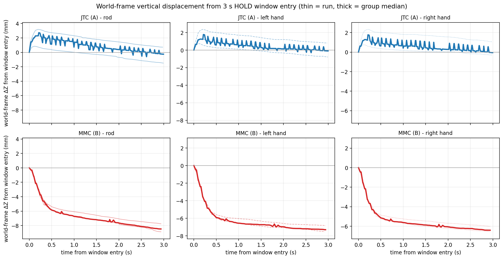
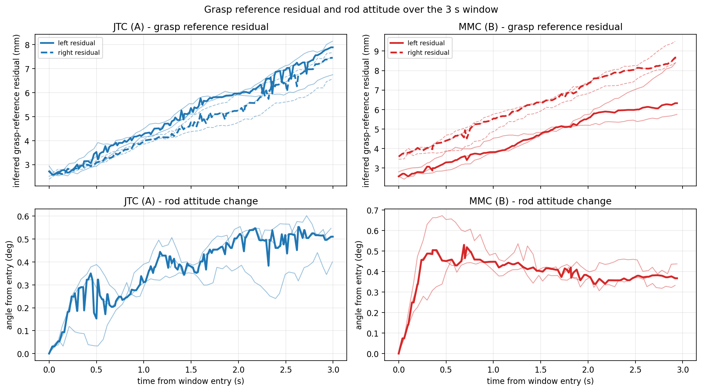
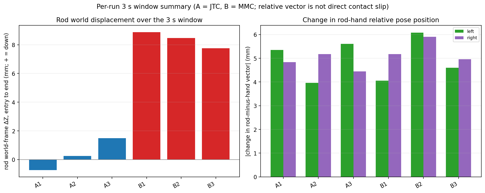
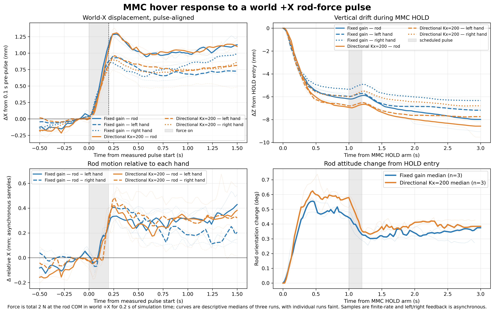
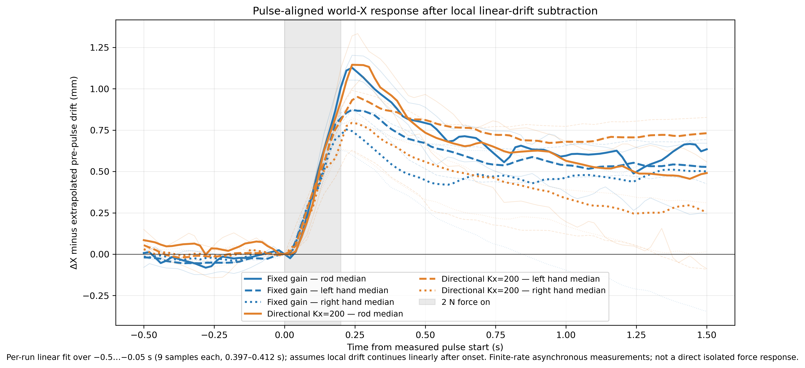

# 刚性 JTC 与固定增益 MMC 悬空保持对照（2026-10-20）

本记录只比较同一版本、模型、场景、抓持参数、hover 入口和保护标准下的两组 3 秒悬空保持：

- **A（JTC）**：`contact_hover_control_mode=jtc`，抬升后由关节轨迹控制器保持。
- **B（MMC）**：`contact_hover_control_mode=mmc_hold`，抬升后 STRICT 切换到固定增益 `sim_multi_mode_controller` 保持。
- 场景固定 `(0.50, 0, +10°)`；JTC 抬升命令 50 mm；HOLD 命令 3.0 s；刚体模型（`rigid=true`，内部 MuJoCo compliance 关闭）；自适应夹持关闭；10 N/指；既有 20 mm / 2° 保护、净空、掉落和 watchdog 均未放宽。
- 原 3+3 组是不加扰动的 JTC / 固定增益 MMC 基线。B_14 作为完整链路历史成功记录保留，**不混入**该基线样本；后续方向性扰动数据也独立列示，不覆盖原 A/B 结果。
- A1/A2/A3/B1/B2 与 B3_retry1 之间唯一的源码差异是切换阶段的健康监测竞争修复（gate 前在途轮次丢弃、每轮记录发出时的状态期望）；它不改变控制律、增益、模型、夹持参数或保护阈值，A 路径也不使用该监测。所有 6 个样本使用同一模型、场景、抓持和保持参数。

## 1. 有效运行与窗口

3 次 A、3 次 B，交替执行，每次单一仿真实例：

| 样本 | run id | 组 |
|---|---|---|
| A1 | `contact_hover_ab_lidio_20261020_A1_retry2` | JTC |
| A2 | `contact_hover_ab_lidio_20261020_A2` | JTC |
| A3 | `contact_hover_ab_lidio_20261020_A3` | JTC |
| B1 | `contact_hover_ab_lidio_20261020_B1` | MMC |
| B2 | `contact_hover_ab_lidio_20261020_B2` | MMC |
| B3 | `contact_hover_ab_lidio_20261020_B3_retry1` | MMC |

**窗口定义**（都在抬升完成后）：

- A：抬升后的第一个 `HOVER_HOLD` 采样为窗口入口，取 3.0 s。
- B：`mmc_hold_trace.csv` 第一行（MMC 首参考确认、实际保持循环开始）的绝对仿真时间为窗口入口，取 3.0 s。启动探针、服务发现和切换都在窗口之前完成。
- 抬升后到 MMC 首参考的切换耗时单独记录：B1/B2/B3 分别为 **0.064 / 0.065 / 0.074 s**，不并入 3 s 主窗口。A 无此切换。
- CSV 采样约 50 ms，窗口内实际样本跨度 A 为 2.98–3.00 s、B 为 2.92–2.94 s；标称窗口均为 3.0 s。

**两种误差口径同时报告**：

1. **抓取参考残差**：任务日志的 `left_slip_m` / `right_slip_m` 是由手位姿和原抓取变换反推的杆中心参考残差，不是接触点/指垫的切向滑移。分别报告窗口入口、窗口末端与窗口内最大值。
2. **窗口新增变化**：末端减入口的抓取参考残差增量，以及同行异步采样中 `(杆 − 手)` 三维相对位置向量的变化量。后者不是直接接触滑移。

窗口入口的杆/双手绝对位姿、四元数和残差保存在 `hover_ab_summary.json`；下表给出入口残差和入口杆/手高度。

## 2. 每次运行结果

| 样本 | 入口抓取参考残差 L/R (mm) | 末端抓取参考残差 L/R (mm) | 残差增量 L/R (mm) | 杆世界 Δz (mm) | 手世界 Δz L/R (mm) | 杆−手相对位置变化模长 L/R (mm) | 杆姿态 Δ (°) | 四侧同时接触采样占比 | 完成 |
|---|---:|---:|---:|---:|---:|---:|---:|---:|---|
| A1 | 2.72 / 2.77 | 7.89 / 7.45 | +5.17 / +4.68 | +0.72 | +0.81 / +1.07 | 5.35 / 4.84 | 0.55 | 56.7% | DONE |
| A2 | 2.94 / 2.72 | 6.75 / 7.67 | +3.81 / +4.95 | −0.25 | −0.10 / −0.05 | 3.97 / 5.17 | 0.51 | 60.0% | DONE |
| A3 | 2.52 / 2.39 | 8.14 / 6.57 | +5.63 / +4.18 | −1.49 | −0.79 / −0.29 | 5.61 / 4.44 | 0.40 | 53.3% | DONE |
| B1 | 2.55 / 3.45 | 5.75 / 8.44 | +3.21 / +5.00 | −8.87 | −7.30 / −6.58 | 4.05 / 5.18 | 0.44 | 66.1% | DONE |
| B2 | 2.80 / 3.58 | 8.37 / 9.50 | +5.57 / +5.92 | −8.48 | −7.55 / −6.42 | 6.08 / 5.90 | 0.33 | 62.7% | DONE |
| B3 | 2.57 / 3.59 | 6.33 / 8.67 | +3.76 / +5.08 | −7.76 | −6.85 / −6.02 | 4.60 / 4.96 | 0.37 | 72.9% | DONE |

入口绝对高度（杆中心 / 左手 / 右手，mm）：A 为 `63.81/162.03/161.38`、`64.50/163.16/162.58`、`66.35/163.79/162.91`；B 为 `65.85/163.21/162.20`、`66.52/163.62/162.71`、`66.79/164.17/162.90`。入口杆姿态和双手四元数见 JSON；这里不把不同样本的绝对高度差当作漂移。

**组范围（3 个样本，仅列范围和 median，不做显著性结论）**：

| 指标 | A（JTC） | B（MMC） |
|---|---|---|
| 杆 Δz (mm) | −1.49 … +0.72，median −0.25 | −8.87 … −7.76，median −8.48 |
| 左残差增量 (mm) | +3.81 … +5.62，median +5.17 | +3.21 … +5.57，median +3.76 |
| 右残差增量 (mm) | +4.18 … +4.95，median +4.68 | +5.00 … +5.92，median +5.08 |
| 杆−手相对位置变化模长左/右 (mm) | 3.97–5.61 / 4.44–5.17 | 4.05–6.08 / 4.96–5.90 |
| 杆姿态 Δ (°) | 0.40 … 0.55，median 0.51 | 0.33 … 0.44，median 0.37 |
| 完成 | 3/3 | 3/3 |

**入口差异**：两组入口左抓取参考残差接近（A 2.52–2.94 mm，B 2.55–2.80 mm）；B 的右入口残差为 3.45–3.59 mm，比 A 的 2.39–2.77 mm 高约 0.7–1.2 mm。因此 B 的右末端累计参考残差有一部分来自进入 3 s 窗口前，不能全部归因于窗口内行为；窗口内右残差增量 B（+5.00…+5.92 mm）也略高于 A（+4.18…+4.95 mm），但两组范围接近。左残差增量范围重叠。

## 3. 图表

- `docs/figures/hover_ab_vertical_displacement_20261020.png`：按各组实际窗口入口对齐的杆与双手世界坐标 ΔZ；每行独立显示一组，但同一列共用纵轴。细线为每次运行，粗线为组中位数。
- `docs/figures/hover_ab_residual_attitude_20261020.png`：原抓取参考下的杆中心残差与杆姿态变化；残差不是局部接触滑移。
- `docs/figures/hover_ab_run_summary_20261020.png`：逐次杆世界下降量、杆−手相对位置变化和完成情况；相对位置变化不是直接接触滑移。
- 机器可读结果：`experiment_results/reports/hover_ab_20261020/hover_ab_summary.csv`、`hover_ab_summary.json`。
- 复现脚本：`python3 -I scripts/analyze_hover_ab.py`（只读原始 run 数据）。
- 原始数据：`experiment_results/a1_runs/<run_id>/`，启动日志：`launch_logs/<run_id>/`；`<run_id>` 见表 1。

## 4. 失败与未计入样本

以下运行未产生有效 3 s 物理窗口，单独保留，不混入上表：

- `contact_hover_ab_lidio_20261020_A1`：动作前 `E_SIM_INFO_UNAVAILABLE`（`/get_sim_info` 响应发送超时），任务未启动，基础设施启动失败。
- `contact_hover_ab_lidio_20261020_A1_retry1`：P3A-2B 下降后、接触动作前 `E_MMC_STATE_SOURCE_NOT_READY`。原因是 JTC 模式不创建 MMC 状态服务，而接触探针无条件要求该服务；已改为仅 `mmc_hold` 要求，未产生悬空保持数据。
- `contact_hover_ab_lidio_20261020_B3`：切换阶段 `controller state conflict`。原因是 gate 前发出的健康查询在 gate 后按新状态期望被评估；无 MMC 保持窗口。已修复为每个查询轮记录其发出时的期望，并在 gate 释放时丢弃在途轮次；修复后该条件以 `B3_retry1` 通过。

B_14（`contact_hover_mmc_hold_lidio_20261020_14`）仍是完整链路历史成功记录；其 2.15 s 抬升后启动等待已由本轮的 pre-lift arming 消除，故不与本轮 B1–B3 合并统计。

## 5. 限制与结论

- 杆真值、关节反馈和左右接触力不是同一同步快照；本文的杆−手相对位置是同行异步读数。
- 原始字段名 `*_slip_m` 在此统一称为**抓取参考残差**：它是杆中心相对原抓取参考的推断量，不是测量到的局部指垫切向接触滑移。杆−手相对 y 方向约 ±4–6 mm 的变化还包含双手相对夹持运动，不能全部称为接触滑移。
- 接触占比是采样计数占比，不是物理时间占空比；本轮不把接触力作为主要优劣指标，原始力尖峰保留在接触 CSV 中。
- 每组 3 个样本，只展示每次结果和范围，不做强统计显著性结论；本轮不宣称抗扰性能。

**基线结论**：MMC 保持可用——3/3 完成 3 秒保持、STRICT 回切和释放。但在当前固定增益下，MMC 组杆在 3 秒内下沉约 **7.8–8.9 mm**，JTC 组为 **−1.5…+0.7 mm**；其中 MMC 组双手也同步下降 **6.0–7.5 mm**，杆–手相对 z 变化约 **−0.9…−2.3 mm**，所以主要差异是整体竖向沉降，而不是全部为指间滑移。残差增量左组重叠、右组 B 略高且 B 入口右残差已高约 0.7–1.2 mm；杆姿态变化 B 反而略小（0.33–0.44° vs A 0.40–0.55°）。这是无外力基线的描述性结果。

## 6. World +X 定向柔顺扰动对照（2026-10-20）

按固定的两组各 3 次运行完成一次小规模比较。固定组沿用当前平移刚度 `K=(400,400,400) N/m`；方向性组只将两臂各自 link0 坐标中的 `Kx` 设为 `200 N/m`，`Ky=Kz=400 N/m`，姿态刚度 `20`、阻尼比 `0.8`、nullspace `10` 及其他参数保持不变。两侧 `mj_*_link0` 的朝向均为单位四元数，因此局部 `+x` 对应同一 world `+X`。阻尼由既有操作空间方法按当前惯量重新计算，没有固定阻尼常数或载荷前馈。

六次均从 `scripts/run_contact_probe_local.sh --headless` 单实例入口运行，固定同一 `(0.50, 0, +10°)` 场景、50 mm JTC 抬升、3 s MMC HOLD、rigid contact probe、adaptive force hold 关闭和原有保护；`CONTACT_PROBE_MMC_CONTROL_VARIANT` 显式设为 `fixed` 或 `directional`，`CONTACT_PROBE_ROD_DISTURBANCE=1`。不加扰动的初始固定组启动失败目录 `contact_hover_directional_fixed_01/` 单独保留，未进入物理动作；有效样本为 `fixed_01_retry1`、`fixed_02`、`fixed_03`、`soft_01`、`soft_02`、`soft_03`。

新增实验入口默认关闭。启用时，任务只向硬件插件发 arm/cancel 请求；插件在 MuJoCo `write()` 物理线程中，于实际 MMC HOLD arm 后 1.0 仿真秒向 `obj_rod_01` 质心施加 world `(2,0,0) N`，仿真时间 0.2 秒后只撤销本入口添加的 X 分力，不写入其他力/力矩分量。`rod_force_events.csv` 记录插件实际 arm、pulse start/end 与向量；六次物理运行均记录到 1.000 s 延迟和 0.200 s 脉冲。运行中无保护触发，均以 `task_state=DONE`、MMC→JTC 正常切换、下降/释放完成；weld 与杆固定约束为 OFF。

| 组 / run id | MMC trace span (s) | 杆 HOLD Δz (mm) | 杆 ΔX：脉冲结束 / 结束后 1 s (mm) | 最大杆姿态变化 (°) | 结果 |
|---|---:|---:|---:|---:|---|
| 固定 `fixed_01_retry1` | 2.954 | −7.952 | 1.109 / 1.079 | 0.569 | DONE，释放 |
| 固定 `fixed_02` | 2.954 | −7.988 | 1.125 / 0.968 | 0.491 | DONE，释放 |
| 固定 `fixed_03` | 2.954 | −9.049 | 1.226 / 1.060 | 0.557 | DONE，释放 |
| 方向性 `soft_01` | 2.950 | −8.575 | 1.146 / 1.089 | 0.630 | DONE，释放 |
| 方向性 `soft_02` | 2.952 | −8.178 | 1.032 / 0.967 | 0.739 | DONE，释放 |
| 方向性 `soft_03` | 2.954 | −9.537 | 1.054 / 1.106 | 0.620 | DONE，释放 |

组中位数：固定组杆 HOLD 下沉 `−7.988 mm`，方向性组 `−8.575 mm`；脉冲结束时杆相对脉冲前 0.1 s 基线的 ΔX 分别 `1.125/1.054 mm`，脉冲结束后 1 s 分别为 `1.060/1.089 mm`。这段约 1 mm 的世界 X 变化同时包含 HOLD 中的背景漂移，不能全部归因于脉冲；结束后没有一致的反向恢复趋势，原始曲线本身不足以分离扰动与背景漂移。

脉冲前每次有 9 个样本，拟合窗口 `−0.5…−0.05 s`，跨度 `0.397–0.412 s`。对杆、左手和右手各自用该窗口拟合局部线性 X 漂移，并假定该斜率在脉冲后继续；表中去趋势 ΔX 是相对施力开始时拟合基线的响应估计，不是单独测得的“净外力响应”：

| 组 / 物体 | 去趋势 ΔX 至脉冲结束 (mm) | 去趋势 ΔX 至结束后 1 s (mm) |
|---|---:|---:|
| 固定 / 杆 | 1.009 (0.988–1.058) | 0.587 (0.331–0.616) |
| 固定 / 左手 | 0.822 (0.790–0.853) | 0.538 (0.478–0.679) |
| 固定 / 右手 | 0.723 (0.627–0.783) | 0.450 (−0.188–0.490) |
| 方向性 / 杆 | 0.924 (0.881–1.124) | 0.533 (0.056–0.666) |
| 方向性 / 左手 | 0.809 (0.531–0.874) | 0.707 (0.074–0.800) |
| 方向性 / 右手 | 0.674 (0.634–0.787) | 0.268 (0.078–0.359) |

去趋势中位数与范围来自每组 3 次独立拟合。固定/方向性杆的结束时估计相近，1 s 后估计范围也重叠；双手结果有个体差异。线性漂移延续是假设，不能保证无扰动轨迹在脉冲后仍保持该斜率，因此这里只作轻量敏感性分析。原始脉冲对齐曲线仍是主观测。图见 [去趋势响应图](../experiment_results/reports/hover_directional_perturbation_20261020/mmc_directional_pulse_detrended.png)。杆姿态最大变化中位数固定 `0.557°`、方向性 `0.630°`；左右反馈时间差的单次最大值在 `16–26 ms`，杆与双手位移为有限频率异步观测。

两组的竖直刚度没有变化，且两组仍分别下沉约 `8.0/8.6 mm`；方向性组在本次短脉冲下没有呈现清晰的 X 向位移增加或可辨恢复优势。相较无扰动固定增益基线 B1–B3 杆下沉中位数 `−8.48 mm`，本次两组下沉处于相近量级。`0.64 kg` 杆重约 `6.28 N`；将其按两个 `400 N/m` 竖直弹簧简化分担得 `7.85 mm`，只作量级参考，不证明下沉根因。每组 n=3，仅报告描述性趋势，不作显著性、鲁棒性或柔顺优越性结论；短脉冲也不要求达到静态估算的 2.5/5 mm。

逐次事件、监测时间差和结果见 [run_summary.csv](../experiment_results/reports/hover_directional_perturbation_20261020/run_summary.csv)；原始记录位于 `experiment_results/a1_runs/contact_hover_directional_fixed_01_retry1/`、`fixed_02/`、`fixed_03/`、`soft_01/`、`soft_02/`、`soft_03/`（均带 `contact_hover_directional_` 前缀）。图可由 `python3 scripts/plot_mmc_directional_perturbation.py` 从原始 CSV 重建。

本次实验入口代码已构建并经过六次完整物理运行验证。最初固定组的动作前 DDS socket 被 sandbox 拒绝，未产生动作；在获准的本机运行环境中按独立目录重启一次，随后完成预定六个样本。没有改接触、夹持、模型、保护阈值或竖直刚度，没有做参数扫描；未提交、未推送。

> 2026-10-20 扩展轮（扩展运输场景仅规划/执行尝试、杆载荷前馈 3+3、启用前馈后的 2 N/1 s 方向性长脉冲 3+3）是独立实验，不覆盖本文的原始 3+3 与 0.2 s 脉冲结果。记录见 [S2/S3 扩展场景与载荷补偿结果](deliverables/S2_S3_扩展场景与载荷补偿_结果_20261020.md)。
