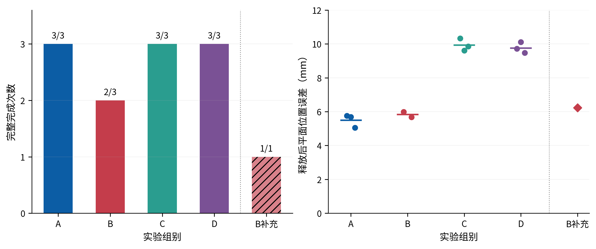

# 完整搬运 A/B/C/D 本轮结果（2026-10-22）

## 当天闭环批次：起点衔接修复与正式对照

本批次沿用固定 S0 `(0.50,0,+10°)→(0.40,0,+20°)`，最多新增 15 次带机械臂动作。实际新增 14 次：两次 B 接线验证完整通过，正式 12 次全部执行（11 次 `DONE`，B1 一次在运输前失败）；一次启动时 Fast DDS UDP 权限错误没有产生机械臂动作，预算不计该启动。旧 `39` 次全部保留为历史，不纳入本批次统计。代码先后经历 5 mrad 与 12 mrad 的**连接入口上限**；实际下发仍以实测起点开始短连接，并保留原 2 mrad 轨迹下发一致性检查。B1 的 5.318 mrad 偏移被初版入口上限拒绝，保留为正式失败；后续验证与 B2/B3 使用 12 mrad 有界连接入口，连接逐点检查关节限值、双臂闭链残差与碰撞。A1/C1 的偏移分别仅 0.079/4.321 mrad，低于两版入口上限，连接执行路径相同。没有改 20 mm/5°承载判据、接触模型、夹持力、刚度、速度参数或保护阈值。

| 组 | 方法 | 完整到达释放与撤退 | 释放 XY 误差（均值，范围） | 绝对 yaw 误差（均值，范围） | 杆底面间隙（均值，范围） | 接触阶段至终态（均值，范围） |
|---|---|---:|---:|---:|---:|---:|
| A | 基础轨迹 + JTC | 3/3 | 5.50 mm（5.04–5.76） | 1.18°（1.13–1.24） | 0.592 mm（0.591–0.594） | 21.79 s（21.45–22.02） |
| B | 时间剖面优化 + JTC | 2/3 | 5.83 mm（5.67–5.99），仅成功两次 | 1.14°（1.06–1.21），仅成功两次 | 0.593 mm（0.592–0.594），仅成功两次 | 24.94 s（24.28–25.61），仅成功两次 |
| C | 基础轨迹 + 独立阻抗 MMC + 载荷前馈 | 3/3 | 9.93 mm（9.62–10.33） | 2.13°（2.00–2.21） | 0.623 mm（0.622–0.624） | 26.88 s（26.34–27.48） |
| D | 优化时间剖面 + 同一 MMC/载荷前馈 | 3/3 | 9.77 mm（9.47–10.11） | 2.00°（1.95–2.02） | 0.618 mm（0.614–0.626） | 29.69 s（29.09–30.88） |

落点数据来自各组释放流程结束时最后一次 A1 杆位姿读回；XY、yaw 和杆底面间隙分开计算。修订版按物理支撑面 `z=0` 重算后，底隙约为 0.59–0.62 mm，均在原 ±3 mm 支撑容差内。旧版把 `0.000654 m` 的沉降偏置误作支撑高度，导致表中间隙少算 0.654 mm；修订不改变 XY/yaw。A/B 的落姿在配置的 `0.5 s` 墙钟等待后读取，C/D 在实测约 `2.0 s` 仿真等待后读取，等待协议不同，因此这些底隙不用于跨组的同等待时刻优劣判断。抓取参考残差均值 A/B/C/D 分别约 9.98/10.33/17.98/18.71 mm，按完整成功运行统计；这是参考残差，不是直接指垫滑移。C/D 以 400 N/m 平移刚度、40 Nm/rad 转动刚度、阻尼比 0.8、nullspace 10 和原 0.64 kg 整体均分、每臂 3.1392 N、0.5 s 斜坡载荷前馈运行，故比较的是“阻抗+载荷前馈”组合。

B1 在抬升后生成了优化候选，优化前后连续 jerk RMS 为 3.643→3.574 rad/s³、导出 RMS 为 3.710→2.417；实际运输因连接入口 5 mrad 上限拒绝，**这些是候选指标，不是执行收益**。按逐次相对自身基线计算，B 的全部 3 个已生成候选运行平均变化为 −1.36%（范围 −1.89% 至 −1.01%），其中成功执行的 B2/B3 为 −1.10%（−1.19% 至 −1.01%）；两种口径分别为 −1.362% 和 −1.099%。D 三次逐次连续 jerk 变化平均为 +3.05%（−0.30% 至 +6.98%），旧“均值之比”口径为 +3.884%。导出曲线逐次变化：B 全部候选 −32.78%、成功两次 −31.75%；D 为 −28.89%，均值之比为 −29.92%。B/D 的候选与基线总运输时长相同，优化不缩短运动时间；B 求解耗时 2.57–2.62 s，D 为 2.63–3.55 s。计入整程后，B 成功两次的接触至终态均值比 A 高约 3.16 s，D 比 C 高约 2.81 s；除求解时间外也包含运行间阶段时长差异。比较导出 jerk 时需同时查看导出偏差（B 成功样本约 0.537–1.934 mrad；D 约 0.166–2.243 mrad）；不能把导出曲线上的下降直接等同于实际执行平稳性提升。

**2026-10-23 口径注记：** 本节 B/D 数值来自修正前优化器，其 cost 实际是导出五次插值曲线 jerk；连续列只能作为历史诊断。新实现已改为直接优化 `1 ms` 连续 jerk，并增加峰值、忠实导出和最终候选检查。正式 12 路径的新离线结果已由用户运行 `scripts/analyze_time_profile_alignment_20261023.py` 生成；旧百分比仍不能写成修正后算法的收益或执行优势。

### 修正后时间剖面离线验收

用户已完成正式 12 个基础运输轨迹的离线性验收，结果见
[`time_profile_alignment.csv`](../../experiment_results/reports/final_tradeoff_20261022/time_profile_alignment/time_profile_alignment.csv)。
12/12 候选满足连续约束、RMS 下降、峰值不增和忠实导出检查，均被接受并选择；没有缺失输入或回放失败。

| 组 | n | 接受/选择 | 连续 RMS 均值 (rad/s³) | 逐次 RMS 变化均值 | 逐次变化范围 | 连续峰值变化均值 |
|---|---:|---:|---:|---:|---:|---:|
| A | 3 | 3/3 | 3.7849 → 3.5570 | −6.01% | −6.57% ～ −5.62% | −25.12% |
| B | 3 | 3/3 | 3.6603 → 3.4686 | −5.24% | −5.69% ～ −4.44% | −13.72% |
| C | 3 | 3/3 | 2.2950 → 2.1956 | −4.35% | −5.36% ～ −3.42% | −7.71% |
| D | 3 | 3/3 | 3.0386 → 2.9052 | −4.42% | −4.63% ～ −4.09% | −9.08% |

所有候选均使用 `5 ms` 导出，最大候选导出位置偏差约 `1.64×10⁻¹³ rad`，远低于 `1e-5 rad` 目标；所有运行均无位置、速度、加速度或闭链/路径约束告警。修正后 B 的逐次连续 RMS 变化均值由旧实现约 `−1.36%` 变为 `−5.24%`，D 由旧实现约 `+3.05%` 变为 `−4.42%`；这说明改变优化目标会改变候选结论，不代表新轨迹已经执行或必然优于旧轨迹。

**边界：** B1 的离线候选虽被接受，但其正式运行仍在运输前失败，`completed_release_retreat=0`；不能把其离线接受写成执行成功。所有结果只对应各自的基础运输计划和原时长，不包含新候选的机械臂执行、实测跟踪、接触力、落点或任务耗时收益。

### R/S 四次完整搬运执行

用户按 `R1 → S1 → S2 → R2` 完成四次固定场景 JTC 完整搬运；R 使用
`CONTACT_TRANSPORT_TIME_SCALE=1.0`，S 使用 `1.2`。四次均到达
`CONTACT_PROBE_RESULT state=DONE`，weld/杆约束/attach 均关闭，并完成释放与 0.15 m 撤退。
逐运行数据见
[`rs_execution.csv`](../../experiment_results/reports/final_tradeoff_20261022/rs_execution/rs_execution.csv)，
组汇总见
[`rs_execution_group_summary.csv`](../../experiment_results/reports/final_tradeoff_20261022/rs_execution/rs_execution_group_summary.csv)，
对照图见 [`rs_execution_comparison.png`](../figures/辅助图/02_正常与慢速搬运对照.png)。
最终时间—平滑度主图为
[`fig_time_smoothness_final.png`](../figures/结题主图/02_运输时间与平滑度.png)。

| 模式 | n | 完成 | 计划运输时长均值 (s) | 动作墙钟时长均值 (s) | 释放 XY 误差均值 (mm) | yaw 误差均值 (°) | 杆底面间隙均值 (mm) | 最大抓取参考残差均值 (mm) |
|---|---:|---:|---:|---:|---:|---:|---:|---:|
| R | 2 | 2/2 | 2.2366 | 2.5412 | 5.75 | 1.12 | 0.592 | 9.53 |
| S | 2 | 2/2 | 2.6787 | 3.2571 | 6.63 | 1.09 | 0.591 | 10.47 |

S 的计划运输时长相对各自基础计划的单次倍率为 `1.2`；实际 MoveGroup 动作墙钟时长均值增加了
约 `0.716 s`，整程接触阶段至终态墙钟均值约为 R `22.26 s`、S `23.32 s`。但每组只有 2 次，
且 R2 的动作耗时明显受到运行开销影响，不能把动作墙钟差直接解释为纯轨迹执行时间。

释放 XY 误差在 S 组均值约高 `0.88 mm`，yaw 和底面间隙差异很小；这不支持 S 在落点精度上更好，
也不足以支持 S 更差的统计结论。四次运行均未见 weld/constraint、控制器冲突或 watchdog/时间源错误。
本步骤执行的是 S 与 R，不执行 O；所有 jerk 结果仍是计划参考曲线指标，不能用低采样率实测位姿
反算成机械臂 jerk。表中的 `max_hold_slip`/抓取参考残差不是指垫局部切向滑移的直接测量。




修订后逐次正式数据：[CSV](../../experiment_results/reports/final_tradeoff_20261022/abcd_s0_formal_runs.csv)；四组汇总：[CSV](../../experiment_results/reports/final_tradeoff_20261022/abcd_s0_group_summary.csv)；两次 B 验证：[CSV](../../experiment_results/reports/final_tradeoff_20261022/abcd_s0_validation_runs.csv)；[离线分析脚本](../../scripts/analyze_abcd_s0_today.py)。旧版汇总与图保留在 `experiment_results/reports/abcd_s0_today_20261022/` 和 `docs/figures/历史归档/旧版统计/`。每个正式 run 的目录在 `experiment_results/a1_runs/abcd_s0_today_*_20261022_*/`。运行顺序为 `A1→C1→B1→D1→D2→B2→C2→A2→B3→A3→D3→C3`。其中 A/C/D 各 3 次完整，B 2/3；没有把失败重跑或删出尝试数。

手动完整观察命令如下；把组别与 run id 改成 A/B/C/D 和新的唯一名称即可。C/D 使用 MMC 与原载荷前馈，A/B 使用 JTC：

```bash
env -u CONTACT_TRANSPORT_PAIRING \
  CONTACT_PROBE_ABCD_GROUP=C \
  CONTACT_PROBE_RUN_ID=manual_abcd_C_$(date +%Y%m%d_%H%M%S) \
  CONTACT_PROBE_START_X=0.50 CONTACT_PROBE_START_Y=0.00 CONTACT_PROBE_START_YAW_DEG=10 \
  CONTACT_PROBE_TARGET_X=0.40 CONTACT_PROBE_TARGET_Y=0.00 CONTACT_PROBE_TARGET_YAW_DEG=20 \
  CONTACT_TRANSPORT_STRETCH=2.0 CONTACT_TRANSPORT_PLAN_ONLY=0 \
  CONTACT_PROBE_HOVER_ONLY=0 CONTACT_PROBE_HOLD_DIAGNOSTIC_ONLY=0 \
  CONTACT_PROBE_ROD_DISTURBANCE=0 scripts/run_contact_probe_local.sh --use-rviz
```

这组数据支持的结论是：B 时间剖面优化在两次实际成功运行中平稳度指标有小幅原生连续 jerk 改善、导出曲线改善较大，但求解约 2.6 s 且一次正式尝试未执行；D 在该指标上原生连续 jerk 未改善。优化前后运输计划时长相同；A 的落放 XY/yaw 误差较低，C/D 的 XY/yaw 误差更大。修订后的底面间隙约 0.59–0.62 mm，各组等待协议不同，不支持“C/D 更贴近支撑面”的跨组结论。完整 MMC 组合没有全面胜过 JTC。样本只有每组 3 次且场景固定，不作统计显著、普遍性能或单因素因果结论。

## 历史正式对照状态（前一批次，保留）

本轮经用户批准将实际动作总上限从 33 提至 39。12 次运行已全部结束，累计 `39/39`；此前 C、D 各一次完整路线连通验证包含在原有 27 次历史动作内，不计入本轮 12 次。正式运行顺序为 `A,C,B,D / D,B,C,A / B,A,D,C`。A=基础轨迹+JTC，B=时间剖面优化+JTC，C=基础轨迹+独立 Cartesian 阻抗 MMC，D=优化时间剖面+同一 MMC。固定起终点 `(0.50,0,+10°)→(0.40,0,+20°)`，承载检查沿用 5°/20 mm 和既有保护。A/C/D 各 3/3 完整；B 三次均在候选生成后、运输下发前以起点偏差超限停止。结果只作每组 n=3 的描述性比较，不作统计显著性声明。

以下旧批次按原样保留，不与当天批次合并统计。

## 历史正式运行结果：S0 固定场景（前一批次 12 次）

按交错顺序完成全部 12 次，合计 39/39 次实际动作。没有基础设施启动失败；每次运行结束后脚本均回收 task/runner/MuJoCo。

| 组 | 方法 | 完整完成 | 释放位置误差均值（范围） | 绝对 yaw 误差均值（范围） |
|---|---|---:|---:|---:|
| A | 基础运输轨迹 + JTC | 3/3 | 5.49 mm（5.24–5.74） | 1.13°（1.10–1.15） |
| B | 时间剖面优化轨迹 + JTC | 0/3 | 无释放数据 | 无释放数据 |
| C | 基础轨迹 + 独立阻抗 MMC + 载荷前馈 | 3/3 | 10.39 mm（9.81–11.06） | 2.14°（2.09–2.20） |
| D | 优化时间剖面 + 同一 MMC + 载荷前馈 | 3/3 | 9.52 mm（8.87–10.00） | 2.01°（1.94–2.08） |

B 三次都成功生成了时间剖面候选；在下发运输时，测得关节起点与轨迹起点偏差为 2.43、3.00、2.46 mrad，超过当前 JTC 运输下发 2.00 mrad 限值。任务按原保护停止，没有执行优化运输，也没有释放姿态数据。这项结果表明现有 B 组执行链与优化计算耗时后的起点状态不匹配；不应解释成“优化轨迹运动效果差”，也不能把候选轨迹生成当成执行收益。本轮额度已到 39/39，没有追加动作或临时放宽保护。

A/C/D 的完整路线均为真实接触、40 cm 抬升、运输/旋转、支撑面下降、松爪与撤退，weld/attach 关闭。D 相比 C 的释放位置误差均值低约 0.87 mm，yaw 误差低约 0.13°，但两组样本范围重叠、每组仅 3 次；不能据此声称明确的轨迹优化收益。A 的释放位置误差低于 C/D；但 C/D 同时使用外部阻抗和杆载荷前馈，而 A 使用 JTC，故这是控制组合的结果，不是单独柔顺算法的因果比较。C/D 的累计抓取参考残差约 18–19 mm，A 约 9–10 mm；该字段是按抓取参考计算的残差，不是直接测得的指垫滑移。

本轮能下的结论是：固定场景下真实无 weld 搬运的 A、C、D 路线可完成；阻抗+载荷前馈组合与刚性基线的落点误差不同，但 MMC 没有在本组指标上显示更优；轨迹优化的 B 组尚不能完成 JTC 运输派发，完整流程效果待验证。以上是一个场景的小样本描述，不外推为普遍结论。

结果文件与可复现分析：

- 逐次汇总：[abcd_s0_run_summary.csv](../../experiment_results/reports/abcd_s0_20261022/abcd_s0_run_summary.csv)
- 图表：[完成率与释放误差](../figures/历史归档/旧版统计/20261022_上一批搬运结果.png)
- 分析脚本：[analyze_abcd_s0.py](../../scripts/analyze_abcd_s0.py)
- 原始运行目录：`experiment_results/a1_runs/abcd_s0_<组别><轮次>_20261022/`；每个目录保留任务日志、仿真日志、逐帧 CSV 和 prepare_status。


## 历史整流程结果：C、D 各完成一次（被当天批次续做）

同一 S0（杆从约 `(0.50,0,10°)` 运到 `(0.40,0,20°)`）下，C 和 D 都完成真实接触夹取、40 cm 抬升、约 0.10 m 运输/旋转、承载下降、回切 JTC、松爪和 15 cm 撤退；两次任务均为 `DONE`，weld/attach 关闭。

| 组别 | 运输方法 | LIFT / 运输 / LOWER | 支撑底隙 | 释放后杆中心 | 撤退 |
|---|---|---:|---:|---|---|
| C | 基础运输轨迹 + 独立笛卡尔阻抗 | 4.466 / 3.026 / 3.642 s | 1.000 s 后 2.978 mm | `(0.395615, 0.007619, 0.020654) m` | 0.15 m，通过 |
| D | 时间剖面优化运输 + 同一阻抗 | 4.371 / 3.021 / 3.690 s | 1.106 s 后 2.990 mm | `(0.394991, 0.009031, 0.020654) m` | 0.15 m，通过 |

D 的优化器记录导出轨迹 jerk RMS `1.002786`；C 的运输是另一条实际关节路径，当前没有同一路径、同一采样口径的优化前 jerk，因此这两个单次运行只能说明完整流程已连通，不能声称 D 的轨迹优化效果更好。C、D 各一次也不足以作统计结论。

本轮撤退修复将**释放后的撤退段**从 5 mm 网格改为 2.5 mm，仍用逐点 IK、保留 0.15 rad 变化检查、固定已释放杆位姿并检查碰撞。C 的真实仿真验证了这项修复。D 的接续改动基于其保留的失败日志：起点连接容差按 MMC 期间实测偏差定为 12 mrad，连接只使用用户授权的 20 mm/5°承载范围并仍检查碰撞；时间剖面优化前后刷新杆真值，避免旧异步请求跨过 3.5 s 超时。最终任务包构建通过。

D 成功前保留了 4 次实际运动失败：两次起点/双臂残差连接检查失败，一次真值请求超时，一次 LOWER 起点偏差 11.82 mrad 超限；这些运行不覆盖也不删除。完整目录见 [C 成功运行](../../experiment_results/a1_runs/contact_C_S0_retreatfine_20261022_01/)、[D `_01`–`_04` 失败运行](../../experiment_results/a1_runs/)和[D 成功运行](../../experiment_results/a1_runs/contact_D_S0_retreatfine_20261022_05/)。

该历史阶段结束时累计实际运动为 `27/33`；后续用户授权将总额提高到 39，并已在本结果开头记录正式运行结论。

## 历史阶段：C 撤退失败与离线定位（已由上方运行验证修复）

以下保留本轮完整验证前的历史记录；其中“C 未成功”只描述当时状态。

追加运行 `contact_C_S0_retreatfix_20261022_01` 完成 S0-C 的抬升、运输/旋转、下降、支撑确认、
MMC→JTC 回切、夹爪释放和放置测量。撤退在左臂第 13 航点报 `E_CONTACT_IK`，没有执行撤退；
该次运行因此仍未完整成功；后续 C/D 完整成功运行见本报告开头。该次运行时总动作计为 `21/33`。

失败原因与 C6 不同：C6 的普通 5 mm 撤退网格返回了解，但随后被 `0.15 rad` 跳变上限拒绝；
本次给 IK 增加该上限的邻近解约束后，30 点撤退在左臂第 13 点直接无解。使用本次真实撤退起点
14 个关节值，在 MoveIt 模型离线比较网格后，30 点失败、60 点成功；60 点最大单步变化
`0.0842 rad`，最大末端位置误差 `0.010 mm`、角度误差 `0.00058°`。离线结果支持撤退网格过稀，
但未执行碰撞检查，不能当作完整路径通过。

生产实现仅将释放后的撤退采样间隔由 5 mm 减至 2.5 mm，同时保留 `0.15 rad` 上限及逐点前一解作 seed；
撤退碰撞检查按放置后的杆真值固定杆位姿，并禁止手指与杆碰撞。`dual_arm_carry_task` 构建成功，
相关已运行测试 2/2 通过，差异格式检查通过。新代码没有真实仿真结果，不能把离线 IK 成功写成 C 完成。
本次 C 原始数据见 [`contact_C_S0_retreatfix_20261022_01`](../../experiment_results/a1_runs/contact_C_S0_retreatfix_20261022_01/)。

## 历史阶段结论（已由本报告开头的最新结果更新）

**未冻结。** 最新独立阻抗 C 已通过承载下降后的支撑检查并释放，但撤退路径规划报错，撤退未执行，故完整 C 未成功；未运行 D。没有进入四候选整路线规划筛选、A/B/C/D 场景筛选、比较图或冻结配置阶段；没有启动冻结后的正式重复实验。未用悬空保持替代完整搬运。

### 最新 C：2 秒上限等待验证与撤退失败

`independent_C_S0_5deg_20261022_6` 在同一 S0 和原独立笛卡尔阻抗设置下完成 LIFT、水平运输/旋转及 LOWER。LOWER 参考 3.673 s 结束后，原计划末端目标、零 twist 和载荷前馈保持；等待 1.073 s 时，新鲜杆真值的底面间隙由 20.019 mm 降至 2.945 mm，进入原 ±3 mm 支撑窗并立即继续，未等待满 2 s。随后 MMC 正常回切 JTC，双爪打开成功，释放后 2.008 s 测量杆真值约 `(0.394691,0.009146,0.020654) m`。这次验证确认最长等待逻辑可在支撑通过时提前退出。

释放后虽记录了 `retreat requested`，撤退 `makePlan(..., "retreat", ...)` 随即因 `E_CONTACT_IK_BRANCH_JUMP` 失败，撤退轨迹没有执行，故 C 仍不算完整成功。该错误对应现有过渡关节最大跳变检查（非有限值或超过 0.15 rad），本次日志没有记录导致失败的具体关节和值；不据此放宽检查或在本轮修复/重跑。按用户要求发生实际搬运失败即停止，未运行 D。

基础设施失败 `_5` 的首个实质错误是 ROS 进程的 DDS 网络初始化被运行沙箱拒绝：`getifaddrs: Operation not permitted`，随后 Fast DDS 报全部 whitelist 接口被过滤、UDP socket 创建 `Operation not permitted`。headless 下 GLFW/X11 无显示的报错随后降级关闭渲染，不是服务缺失根因。未改脚本或超时；将同一 C 命令置于允许本机网络 socket 的执行环境后，服务即出现，验证运行继续。`_5` 无 manifest 且无机械臂动作，不计搬运动作。

本次 C6 实际进入搬运，累计动作由 19 增至 `20/33`；新增两次集成额度中已消耗一次实际搬运动作，另一次因 C 失败停止而未用于 D。正式 12 次保持未动。C6 原始日志和 CSV 保留于 [`independent_C_S0_5deg_20261022_6`](../../experiment_results/a1_runs/independent_C_S0_5deg_20261022_6/)，基础设施启动失败保留于 [`..._5`](../../experiment_results/a1_runs/independent_C_S0_5deg_20261022_5/)。不提交、不推送。

### 上一次 LOWER 等待验证前的启动失败

（历史 `independent_C_S0_5deg_20261022_5`，原因及修复结果见上方最新 C 记录。）

### 等待上限实现与首次 C 启动失败记录（_5，后续已启动成功）

按最新要求，LOWER 轨迹结束后仍保持计划末端目标、零 twist 和原载荷前馈；现在最长等待是从末点观察起算的 **2 秒总上限**（包含原先 0.5 秒），每 10 ms 走现有 `observe("LOWER_SETTLE", false)`。首次或后续新鲜真值满足原 `abs(bottom_gap) <= 3 mm` 就立即离开循环；超时未满足则以 `E_CONTACT_LOWER_SETTLE_TIMEOUT` 失败，不释放。等待期间原接触/滑移/姿态/位置/真值时效检查、bridge 健康轮询和控制器力矩保护保持运行。既有 before/after 日志继续记录实际 elapsed 与杆底面间隙。没有改高度、刚度、夹持、前馈或验收值。

`rtk colcon build --packages-select dual_arm_carry_task` 定向构建通过（1 包）；`rtk git diff --check` 通过。随后按同一 S0 与原配置启动 C，运行目录为
[`independent_C_S0_5deg_20261022_5`](../../experiment_results/a1_runs/independent_C_S0_5deg_20261022_5/)。运行器在 startup 阶段因 `/set_body_state`、`/get_body_state`、`/get_sim_info` 未在 120 s 内出现而报 `E_SERVICES_UNAVAILABLE`；MuJoCo 控制器日志显示 JTC 已激活，但场景服务检查没有通过，`manifest_present=false`，没有进入 task runner 或发生机械臂动作。故这次不构成 C 验证，2 秒等待行为尚无运行结果；D 未启动。遵照“任一次失败即停止”，不重跑 C、不运行 D。该启动失败目录保留。

上次已完成的 19 次实际动作记录保留；本次没有机械臂动作，故实际累计仍为 `19`，总上限按用户授权调整为 `33`。正式实验 12 次未使用；本次 C/D 验证未完成，不把构建通过当作实验通过。本轮未提交、未推送。

### 新增一次 S0-C：验证 LOWER 末点等待

按用户明确追加的 1 次集成动作额度，以原 S0 与既有独立笛卡尔阻抗配置运行
`independent_C_S0_5deg_20261022_4`。日志确认方法为 `independent_cartesian_v1`，
承载判据 `20.0 mm / 5.0°`，每臂 `Kdiag=(400,400,400,40,40,40)`、阻尼比 `0.8`、
nullspace `10`，0.64 kg 载荷按原 0.5 s 斜坡前馈；运输目标仍为 S0 的 `(0.40, 0, +20°)`。
夹持力、接触模型、碰撞规则和保护未改。LIFT（4.371 s）及 TRANSPORT（3.018 s，
约 0.101 m / +9.8°）完成，LOWER 参考播放 3.780 s。

LOWER 末点等待实测为 0.505 s。`ABCD_MMC_LOWER_SETTLE` 前后两条记录中的计划左右末端目标
逐项相同，等待后才触发 `ABCD_MMC_FAILURE_STOP`；所以等待期间仍由原参考流维持计划末点，
没有把目标重置成当前实测位姿。等待前后（同一日志记录的仿真观测）：左手实测世界 z 从
0.150294 降至 0.139322 m（−10.972 mm），右手从 0.150854 降至 0.139235 m（−11.619 mm）；
杆中心 z 从 0.045624 降至 0.034080 m（−11.544 mm）。按杆真值姿态计算的杆底面间隙从
19.779 降至 7.749 mm（收敛 12.030 mm）。因此等待期间双手和杆确实继续下降，末端并未停在原半空位置；
但结束时底面仍高于原 ±3 mm 支撑窗口上界约 4.749 mm。新鲜真值的原支撑检查遂报
`E_CONTACT_RELEASE_NOT_ON_SUPPORT`。无其他保护先触发；失败流程停止 MMC、确认回切 JTC，
保持夹爪，未释放、未撤退。完整 C 仍未成功，按用户要求不延长等待、不改目标、不重跑，也未运行 D。

本次运行目录及失败结果完整保留于
[`independent_C_S0_5deg_20261022_4`](../../experiment_results/a1_runs/independent_C_S0_5deg_20261022_4/)，
关键证据在 `task_launch.log` 的 `[ABCD_MMC_LOWER_SETTLE]`、`[ABCD_MMC_ABORT]`、
`[CONTACT_PROBE_RESULT]` 及既有 `contact_probe.csv` 的 `LOWER_SETTLE` 行。原历史 18 次记录不变；
本次实际执行了承载动作，故累计为 `19/31`，追加的集成额度已用，正式 12 次仍全部未动。
没有筛选或冻结场景、没有正式统计。本次未提交、未推送。

### 最新续做：恢复历史独立笛卡尔阻抗（S0-C）

按用户最新指定，保留协同阻抗 v2 实现及其失败记录，本次关闭共模/相对 wrench 分支，恢复 C12–C14 实际运行过的双臂独立笛卡尔阻抗。历史日志与当前桥接调用链核对一致：每臂 FK/Jacobian 参考、`Kdiag=(400,400,400,40,40,40)`、阻尼比 0.8、零空间 10、杆载荷 0.64 kg 分臂并以 0.5 s 斜坡前馈一次；原 10 N/指夹持、接触模型、碰撞/力矩保护及 5°/20 mm 判据不变。C12/C14 日志确认历史路径采用相同增益与前馈配置。

- `independent_C_S0_5deg_20261022_1`：新独立参考将 3×3 旋转矩阵乘到 6 维 twist，Eigen 断言中止；任务此前已执行预抓取、下降和闭爪，故作为一次未进入承载阶段的实际动作失败计入预算。保留运行目录。
- `independent_C_S0_5deg_20261022_2`：JTC spawner 尚未完成时控制器枚举过早，启动脚本报 `E_MMC_CONTROLLER_PRESTATE`，机械臂未动作。已将启动检查改为最多 30 s 等待 MMC inactive 且 JTC active；保留目录。
- `independent_C_S0_5deg_20261022_3`：定向构建和脚本语法检查后执行同一 S0-C。日志确认活动方法为 `independent_cartesian_v1`、共模/相对 wrench 关闭、每臂刚度 `400/400/400/40/40/40`、阻尼比 0.8、载荷 0.64 kg/0.5 s、5°/20 mm。LIFT 4.371 s 完成，杆中心 z 从约 0.0208 m 到 0.4160 m；TRANSPORT 3.022 s 完成，约 0.10 m 平移并旋转约 +9.7°；LOWER 3.644 s 的参考段完成，杆中心最低到 z=0.04595 m，但未达到约 0.020 m 支撑目标。释放前支撑条件失败 `E_CONTACT_RELEASE_NOT_ON_SUPPORT`：诊断时左夹爪仍有双垫接触、右夹爪无垫接触，杆仍有约 5 N 竖向接触力；保护停止后确认 MMC 停止并回切 JTC，任务为 FAILED。未释放、未撤退，故完整 C 不成功；不运行 D，也不筛选/冻结场景。

本次失败直接由支撑确认条件未满足触发，现有记录只说明下降参考结束时杆仍约高于目标 26 mm，不能据此唯一归因于控制器或单一接触原因。没有新的明确软件修复依据，不按同配置重试、不改变控制参数。协同 v2 的已有失败结论与数据均保留，不将本次 C 计为正式样本。按带机械臂动作的运行计数：Eigen 失败的 `_1` 已预抓取/下降/闭爪，计 1 次；控制器启动竞态 `_2` 在机械臂动作前退出，不计；独立阻抗 C `_3` 计 1 次。因此新增实际动作 2 次，累计 `18/30`，集成/筛选额度用尽（本阶段余 0），正式实验 12 次未使用。场景未冻结；ABCD 完整对照及其比较图尚未开始。

### 5°统一判据下的最新运行

用户已将 ABCD 承载运动的手—杆姿态允许值统一改为 5°；本次运行日志确认实际配置为 `lift_slip_limit=20.0mm/5.0deg(user-authorized)`，并继续保留 20 mm 位置限制。无需修改或重建代码。

- `coop_v2_C_S0_5deg_20261022_1`：同一 S0、协同阻抗 v2、10 N/指真实接触。C 在 LIFT 阶段杆中心升高约 89.9 mm 时由原接触残差保护停止，未到 0.40 m 抬升端点，也未开始水平运输。接触 CSV 最大手—杆位置残差左/右为 8.02/12.63 mm，均小于 20 mm；最大角度残差左/右为 5.34°/7.09°，超过本次实际 5°条件。停止附近左侧法向力降至 0，右侧仍有法向接触；无 weld 或杆约束，失败后确认 JTC active、MMC inactive。
- 停止前最近一次协同误差日志（真值年龄 20.8 ms）记录共同物体跟踪误差 13.712 mm/3.876°、相对手误差 11.508 mm/4.346°；之后接触姿态继续偏离并触发5°保护。此次失败不是旧2°门限导致，也不是20 mm位置门限导致。
- 本轮在最新 5°判据下新增 1 次实际搬运动作，累计 `16/30`，集成/筛选余 `2`，正式 12 次未使用。C 未完整成功，故不运行 D、不筛选/冻结场景、不开始正式实验；当前没有新的软件实现错误依据支持修复，也不重复同配置试跑。

### 后续协同阻抗方法集成结果

本轮已沿现有 MMC 力矩链实现 `cooperative_object_relative_v1/v2`：共同物体 wrench 与零合力/零合矩的相对纠偏项分别计算，按抓持点力矩平衡分配到两臂，再旋转到各自 link0 坐标；保留异步 MuJoCo 真值、载荷前馈一次、原碰撞/力矩/接触保护和失败回切。消息新增字段默认关闭，A/B、历史独立 MMC 与 JTC 入口保持原语义。模态等效映射采用物体共同刚度 `800 N/m, 80 Nm/rad`、相对刚度 `200 N/m, 20 Nm/rad`，阻尼比均为 0.8 并按对应质量/转动惯量重算；这是保持原每臂 `400 N/m, 40 Nm/rad` 的推导，不是已验证的最优增益。

- 定向构建 `multi_mode_control_msgs multi_mode_controller dual_arm_carry_task` 通过；生产计算数学单测 `test_cooperative_impedance` 通过（4/4）。一次聚焦独立审阅未发现 wrench 平衡、坐标转换、控制器并发或失败回切阻断项。
- `coop_obj_C_S0_20261022_run1`（v1）：真实接触后进入 MMC，但抬升约 55 mm 时触发原 `2°/20 mm` 滑移保护；触发前记录的共同物体跟踪误差达 29.466 mm/2.144°，相对手误差 8.143 mm/2.618°。真值年龄 10 ms，MMC 流最大间隔 10.098 ms；真实接触仍在，无 weld/约束，失败后确认 JTC active、MMC inactive。未进入水平运输。
- `coop_obj_C_S0_20261022_run2`（v2）：按模态等效关系降低相对项、提高共同项后再次运行同一 S0。触发样本两侧手—杆角度残差分别约 2.20°/2.14°，平移残差最大约 7.33 mm；因此由姿态保护停止。双手角度残差接近，显示该次阻断主要表现为共同手—杆转动偏差，而非明显的两手相对角度差。触发时右侧只有一个指垫接触，切向力约 19.68 N、法向力约 10.57 N；左侧两垫切向力约 8.08/13.63 N、法向力约 11.14/9.29 N。此接触不对称与共同偏差同时出现，但现有采样不足以断言唯一根因。失败后真实接触保留、无 weld/约束，并确认回切 JTC。
- 两次都未完成 C；因此未运行 D、A/B、新候选筛选、场景冻结或正式 12 次实验。按实际搬运动作计，本轮已用集成/筛选额度 2/5，余 3；正式实验额度未动。当前数据没有给出不改变抓持力、接触模型、保护值或未经验证增益的明确控制修复依据，不能据此继续盲目改参或宣称协同方法完成。

### C14/C15 当前续做结果

- C14（`abcd_s0_C_20261022_14`）：沿用 S0、C 参数与 10 N/指真实接触，LIFT 4.370 s、TRANSPORT 2.243 s 完成。LOWER 下降约 0.311 m 后触发原角度保护；杆中心 z=`0.107362 m`，左/右接触角残差约 `2.04°/1.49°`，位置残差仍在 20 mm 条件内，真实接触仍存在。未支撑、未释放或撤退；确认停止参考并回切 JTC。
- C14 的 2 Hz 分项轨迹中，软避碰 `tau_collision` 两臂全程为零。LOWER 零空间力矩最大范数约 `0.406 Nm`，主任务力矩最大约 `2.690 Nm`；原始力矩等于施加力矩，限幅计数为 0。LOWER 期望四元数稳定，实测左/右姿态偏差逐渐增至约 `3.04°/2.79°`。因此本次不能归因于软避碰力矩、异常参考跳变或输出限幅。
- C15（`abcd_s0_C_20261022_15`）：同一设置进入 MMC LIFT 后，在杆约升高 `82 mm` 时由原接触保护停止。最后残差左/右约 `2.011°/1.369°`；双侧仍有接触记录、命令夹持上限仍为 10 N，最大参考间隔 `10.138 ms`，无力矩限幅。未开始运输。该次不是完整 C 成功。
- 活动控制器现使用同锁按值快照读取状态、质量矩阵、科氏力和 Jacobian。聚焦只读审阅确认该活动路径的数据布局/生命周期正确，更新后计算也在同一控制更新链内串行；所以此一致性改进没有被当作 C12–C15 物理失败的已证实根因。聚焦审阅另指出其他未活动控制器仍使用 RobotData 解锁后引用接口；不在当前活动实现范围内扩改。
- 修复后 `multi_mode_controller`、`dual_arm_carry_task` 定向构建通过，`git diff --check` 通过；在临时可写 `ROS_HOME` 和可用本机 DDS 下，`test_mmc_state_service` 15/15、`test_gripper_client_faults` 11/11 通过。整包 `colcon test` 中功能 gtest 大多通过，但首次运行有上述两个用例因沙箱 ROS 日志目录/DDS socket 限制在 teardown 崩溃；另有既有 lint/copyright 与 xmllint 网络 schema 用例失败，不将整包测试宣称为全绿。诊断用高频扭矩日志已从生产控制路径移除，运行产物仍保留其证据。

C12–C15 表明当前独立双臂柔顺方案在真实接触承载时未将姿态残差保持在原 2°边界内。需进一步降低相对滑移的话，要引入物体级双臂耦合柔顺/抓持约束，或更改接触模型/验收条件；这些都超出当前冻结方法和保护边界。本轮停止，不将其包装成小修，也不盲目加刚度、减速、加夹持力或放宽阈值。当前实际搬运动作累计 `13/30`，集成/筛选余 `5`，正式 12 次未使用。D、场景筛选、冻结及正式统计均未开始。

### 最新连续执行（C09–C13）

按最新版完整任务继续修复并运行同一 S0，没有换场景、调整刚度/夹持力或保护值。活动阻抗控制器保存 `RobotData::state()` 局部副本后再映射 q/dq/O_T_EE，消除临时状态销毁后仍读取 Eigen Map 的生命周期错误；用最小 ASan 复现确认旧写法触发 stack-use-after-scope，局部副本写法通过。MMC 段间规划期间新增实测末端保持目标及零 twist，沿用同一参考流和连续载荷前馈；传递 MMC transport/lower 起始容差以覆盖规划期间真实测得的柔顺状态漂移，原有接触 20 mm/2°、碰撞及力矩保护未改。

- C09：MMC 完成抬升，运输规划期间实测关节状态相对规划起点漂移约 8.05 mrad（手部约 2.74 mm、0.063°），原 2 mrad 起点一致性检查拒绝派发；回切 JTC。此证据支持仅对 MMC 规划等待段使用既有 10 mrad dispatch allowance。
- C10：同一 S0 在 MMC 抬升中触发既有接触残差保护；左角度残差约 2.006°，位置残差约 5.24 mm，超过 2°角度条件而非 20 mm 位置条件；无运输。
- C11：加了实测末端阶段保持后，LIFT 完成；TRANSPORT 派发仍因原 2 mrad 检查失败。记录的最大关节起点差 8.046838 mrad（mj_right_joint6），手部差 2.735 mm/0.0629°；失败后正常回切 JTC。
- C12：将 MMC transport/lower 起点一致性检查设为 10 mrad 后，LIFT（规划 4.466 s）和真实接触 TRANSPORT（3.041 s，约 0.10 m 且目标旋转 +10°）均完整通过。参考流最大间隔分别 10.168 ms、10.605 ms；段间零 twist 实测保持与载荷前馈连续。LOWER 规划 3.650 s 后下降约 0.31 m，左手相对角度达 2.029°，触发既有 2°保护；位置残差约 7.43 mm，接触仍存在，真值杆中心仍高于支撑面约 85 mm。未到支撑确认，不回切后释放、不开爪、不撤退。日志显示非有限力矩与幅值限幅计数均为 0。保留全 CSV 和失败收尾记录。
- 聚焦独立审阅发现，MMC 接受 2–10 mrad 起点差时还应验证实际到规划首点的短连接路径。现用原 `valid()` 检查沿双臂关节插值的状态，逐 1 mrad 复用双臂边界、推算闭链/支撑及 PlanningScene 碰撞检查；增量不超过 2 mrad 时仍走既有容差路径。正常流程仅允许 MMC transport/lower 采用该 10 mrad 起点容差，接触 20 mm/2°等阈值未变。审阅记录也明确：该有效性检查使用规划模型和手部推算杆姿态，不等同于同步 MuJoCo 真值检查。
- C13：为实际走过新增短连接检查，在同一 S0/固定参数下再运行一次。LIFT 4.370 s、TRANSPORT 2.244 s 完成，最大参考间隔 10.239 ms。LOWER 起点偏差 4.098078 mrad，5 个 1 mrad 间隔检查通过后开始 MMC 下降；下降中左角度残差达到 2.020°并触发原保护。最后可用 CSV 样本 z=0.109029 m（目标支撑中心约 0.020 m），左位置残差 7.656 mm、右 5.768 mm；接触仍有双侧数据，未支撑、未释放、未撤退，失败后确认回切 JTC。C13 运行发生在最后将采样端点纳入检查及日志措辞精确化之前；最终代码已再次定向构建，未再执行动作。

C12/C13 时的阶段性结论：完整 MMC 水平运输及旋转已接通，但固定接触模型、增益、夹持力和保护下的承载下降仍超过原姿态保护。C13 已验证短连接检查能在发布下降参考前通过；它没有消除下降中的物体/手姿态残差。截至该时点新增 5 次实际搬运动作，累计历史+本任务 11/30，集成/筛选余 7 次，正式实验未启动。后续 C14/C15 及当前状态见上文。

上一轮续做的两次动作均用于同一 S0 的 C。第一次因杆体真值缓存过期中止；第二次进入 MMC 提升后因姿态残差略超限中止。累计集成动作 4 次，C 未完成，因此未运行 D。

上一轮已将四组共用的 LIFT 轨迹在既有最终时间伸缩后统一放慢 1.5 倍，并取消 ABCD 共用的固定 2 s 悬空 HOLD。C06 规划 LIFT 时长为 4.3713 s，位置轨迹不变；当时在 MMC 提升段因左手姿态残差超过 2° 停止。

本轮只把完整搬运 C/D 的三轴转动刚度从 20 提到 40 Nm/rad，保留平移刚度 400 N/m、阻尼比 0.8、夹持力、时间倍率和保护值；按控制器原有操作空间惯量 `sqrtDesign` 每周期重算阻尼。历史静止 HOLD 桥接器仍使用默认 20。C 在 MMC 抬升中再次以左手角度残差越过 2° 而失败；C 未完整完成，未运行 D。当前累计实际搬运动作 6/12，余 6；本轮 C 失败后停止，不继续扫描参数。完整搬运仍未通过。

## 实施与验证

- C/D 共用 MMC 参考路径：任务定时器是唯一参考发布源；运动段发布 14 关节轨迹五阶插值、双臂分别计算的 Jacobian 位姿/twist 与零空间参考，段间持续发布末端保持目标和零 twist，0.64 kg 载荷前馈连续渐增。桥接器外部参考模式不再竞争发布，0.5 s watchdog 保留；失败时有界尝试严格回切 JTC、核实互斥状态并用测量状态初始化 JTC。
- `refreshTruthBeforeLift()` 在桥接 readiness 后、MMC 切换前有界刷新；唯一保持参考定时器已运行，JTC 仍 active。后续段间也在保持流持续发布时刷新，不改变真值年龄阈值或失败判定。
- 在实际双臂模型上直接调用生产 Jacobian 转换路径，对具名 qdot 映射后的 `J*qdot` 与 FK 有限差分进行核对：左右臂线速度最大误差分别 `2.33e-11`、`7.17e-12`，角速度最大误差分别 `7.85e-11`、`1.21e-11`；日志确认 MoveIt model frame 到各自 link0 的转换。
- 做了一次聚焦独立审阅，并在失败收尾修改后复审；未发现阻断问题。失败时保留 controller state 未确认的明示路径及 watchdog 兜底。
- P2b 的反馈年龄时间点在复制新鲜机械臂反馈和左右夹爪反馈之后采样；左右夹爪年龄共用该时间点计算。未裁剪负年龄，也未放宽新鲜度或数值阈值。
- 提供的 P2b 日志中 `right_age=-0.000019`，分类器随后把右指反馈误判为 stale；修正后的代码顺序消除了“取时刻早于取样本”的竞争窗口。该旧日志保留为故障证据，本轮没有重跑原柔顺演示，因此真实演示回归尚未验证。
- `rtk colcon build --packages-select dual_arm_carry_task` 成功；`test_mmc_activation_handshake`、`test_bridge_process`、`test_time_profile_optimizer`、`test_payload_feedforward`：4/4 通过；`git diff --check` 通过。
- 最终 `rtk colcon build --packages-select dual_arm_carry_task` 成功；`test_mmc_activation_handshake`、`test_bridge_process`、`test_payload_feedforward`、`test_s1_time_scaling`：4/4 通过；加载 ROS/workspace 并允许本机 DDS 后 `test_mmc_state_service` 15/15 通过。`git diff --check` 通过。`multi_mode_controller` 与 `dual_arm_carry_task` 两个受影响包均已定向构建。
- 本轮 `rtk colcon build --packages-select dual_arm_carry_task` 成功；`test_s1_time_scaling`、`test_mmc_activation_handshake`、`test_bridge_process`、`test_time_profile_optimizer`、`test_payload_feedforward`：5/5 通过；伸缩测试核实位置不变、时长乘 1.5、速度除以 1.5、加速度除以 2.25。
- 本次 Krot 改动的 `rtk colcon build --packages-select dual_arm_carry_task` 成功；`test_mmc_activation_handshake`、`test_bridge_process`：2/2 通过，`git diff --check` 通过。C 的 MMC 参数服务日志记录左右臂均已应用 `Kdiag=(400,400,400,40,40,40)`、阻尼比 0.8；控制器参数回调逐臂写入刚度和阻尼比，实时循环通过 `sqrtDesign(pandaCartesianInertia(...), stiffness, damping_ratio)` 重算阻尼。未改动阻尼算法或保护值。

## 保留的运行记录

| 运行目录 | 结果 | 阶段与原因 |
|---|---|---|
| `experiment_results/a1_runs/abcd_s0_C_20261022_01/` | 启动失败，未发生动作 | launch 参数类型异常（`InvalidParameterTypeException`），没有进入任务执行。保留原日志。 |
| `experiment_results/a1_runs/abcd_s0_C_20261022_02/` | 动作尝试 1/2，失败 | 双侧接触闭合并切入 MMC；首条参考计算时把非链式 `dual_panda` 组用于 Jacobian，报 `E_ABCD_MMC_JACOBIAN`。已改为分左右臂组计算。无完整搬运段完成。 |
| `experiment_results/a1_runs/abcd_s0_C_20261022_03/` | 动作尝试 2/2，失败 | 双侧接触闭合并切入 MMC；首个监控周期发现杆体缓存年龄 2.773463 s，报 `E_CONTACT_TRUTH_STALE`。已在 MMC 首条参考前增加有界刷新。无完整搬运段完成。 |
| `experiment_results/a1_runs/abcd_s0_C_20261022_04/` | 续做动作 1/2，失败 | 实际双臂 Jacobian 检查通过。真值刷新发生在桥接 readiness 等待前，缓存随后老化至 2.202192 s；首个 MMC 提升监测报 `E_CONTACT_TRUTH_STALE`。桥接确认切回 JTC。保留日志及数据。 |
| `experiment_results/a1_runs/abcd_s0_C_20261022_05/` | 续做动作 2/2，失败 | Jacobian 检查与 readiness 后、切换前真值刷新通过，刷新期间保持参考持续发布；进入 MMC 提升后，约 65 mm 杆体上升时触发 `E_CONTACT_SLIP_OR_DROP`，未到水平运输。桥接确认切回 JTC。保留日志及数据。 |
| `experiment_results/a1_runs/abcd_s0_C_20261022_06/` | 本轮动作 1/最多 2，失败 | 固定 S0 和控制参数；LIFT 规划时长 2.9135→4.3713 s，ABCD HOLD=0。MMC 提升时以 `E_CONTACT_SLIP_OR_DROP` 停止：停止行左/右位置残差 4.40889/3.55708 mm（20 mm 限值内），角度残差 2.05404/1.94013°（左侧超过 2°）；全 CSV 最大位置残差 5.04333 mm，最大角度残差 2.05404°。杆中心位置 `(0.505923, 0.001223, 0.079281) m`，起始 z=`0.020654 m`。参考最大间隔 0.010130 s，共发布 373 条；JTC/MMC 状态按预期互斥。停止后未到完整 LIFT 端点、运输或放置。保留日志及数据。 |
| `experiment_results/a1_runs/abcd_s0_C_20261022_07/` | 运行环境启动失败，未发生动作、不计入搬运动作 | 受限执行环境拒绝 ROS/DDS UDP socket（`Operation not permitted`、`All whitelist interfaces were filtered out`），服务等待 120 s 超时；脚本已回收本轮仿真实例。日志保留。 |
| `experiment_results/a1_runs/abcd_s0_C_20261022_08/` | 本轮 C 动作，失败 | 同一 S0；LIFT 规划时长 4.4659 s，1.5 倍时间倍率、HOLD=0。MMC 参数服务成功应用左右臂 `K=(400,400,400,40,40,40)`，阻尼比 0.8。抬升中 `E_CONTACT_SLIP_OR_DROP`；任务 CSV 最大左右位置残差 5.890/5.117 mm（20 mm 内），最大左右角度残差 2.006/1.456°（左侧超过 2°）。最后可用接触样本杆中心 `(0.503845,-0.002066,0.113775) m`，起始约 `(0.499532,0.000655,0.020841) m`，上升约 92.9 mm；接触 CSV 首末近邻物理姿态样本的杆姿态变化约 2.36°。数据止于 LIFT，无运输、下降、释放或撤退。参考最大间隔 0.010146 s，共发布 415 条；失败收尾确认已切回 JTC、MMC inactive。保留日志及数据。 |
| `experiment_results/a1_runs/abcd_s0_C_20261022_09/` | 本任务动作 1，失败 | MMC LIFT 完成（4.370 s）；transport 规划后的 measured/planned 起点差约 8.05 mrad，超过 2 mrad dispatch 限值，报 `E_ABCD_MMC_DISPATCH_START_MOVED`，未开始水平运输。回切 JTC。 |
| `experiment_results/a1_runs/abcd_s0_C_20261022_10/` | 本任务动作 2，失败 | 固定 S0/C 参数；MMC LIFT 中 `E_CONTACT_SLIP_OR_DROP`。左角度残差约 2.006°，位置残差约 5.24 mm；达到原姿态阈值，没有水平运输。 |
| `experiment_results/a1_runs/abcd_s0_C_20261022_11/` | 本任务动作 3，失败 | 实测阶段保持后 MMC LIFT 完成（4.370 s）；transport 起点关节差 8.046838 mrad（mj_right_joint6），末端差 2.735 mm/0.0629°，超过原 2 mrad dispatch 检查。未开始水平运输；回切 JTC。 |
| `experiment_results/a1_runs/abcd_s0_C_20261022_12/` | 本任务动作 4，失败 | MMC LIFT 4.466 s 和真实接触 TRANSPORT 3.041 s 完成；LOWER 下降约 0.31 m 后左侧角度残差 2.029°触发原保护，位置残差约 7.43 mm，杆中心仍高于支撑约 85 mm。接触在、未到放置，不释放或撤退；失败停止并回切 JTC。数据完整保留。 |
| `experiment_results/a1_runs/abcd_s0_C_20261022_13/` | 本任务动作 5，失败 | LIFT 4.370 s、TRANSPORT 2.244 s 完成。LOWER 起点差 4.098078 mrad，模型内双臂插值连接检查通过后下降；左角度残差 2.020°触发原保护。最后 CSV 杆中心 z=0.109029 m，目标约 0.020 m，位置残差左/右 7.656/5.768 mm。未放置、释放或撤退；确认回切 JTC，保留数据。 |
| `experiment_results/a1_runs/abcd_s0_C_20261022_14/` | 本任务动作 12，失败 | LIFT 4.370 s 和 TRANSPORT 2.243 s 完成；LOWER 下降约 0.311 m 后左角度残差约 2.04°触发保护。杆中心 z=0.107362 m，未支撑/释放/撤退；已确认回切 JTC。保存姿态与分项力矩诊断轨迹。 |
| `experiment_results/a1_runs/abcd_s0_C_20261022_15/` | 本任务动作 13，失败 | 原 S0/C 设置，LIFT 中杆上升约 82 mm 时左角度残差 2.011°触发保护，右约 1.369°；真实双侧接触仍有数据，未发生运输。停止后确认回切 JTC。保留全部 CSV 与日志。 |

所有运行目录及失败数据均保留；早期 C07 是启动环境失败，不计入搬运动作。本任务截至 C15 共新增 8 次实际搬运动作（C08–C15），加此前累计 5 次为 `13/30`，本任务集成/筛选额度余 5 次。C 未完整成功，未运行 D，也未进行四候选规划筛选；S0–S3 均无本轮完整路线筛选结论。没有比较图和冻结 YAML，未从部分运行中挑选展示场景。

## 下一步边界

本轮 C/D 失败后按整体任务边界停止：不运行 D，不继续扫描时长倍率、刚度、夹持力或其他参数，不换位置。当前证据要求改为物体级双臂耦合控制或变更接触模型/验收定义，须先调整研究方向。失败动作不通过改名或重置计数抹除。本轮不筛选或冻结场景，未提交、未推送。

## 随后只读核对：05 的实际停止条件

对 `abcd_s0_C_20261022_05/contact_probe.csv` 的 67 行逐条检查：最大位置抓取参考残差
7.0043 mm，低于 20 mm；最大角度残差 2.01473°，超过 2°。仅最后一行越过该条件，
末行左右角度分别为 2.00497°、2.01473°。该错误由代码的“位置或角度”合并分支发出，
因此此次停止直接由角度残差触发，不能将 `E_CONTACT_SLIP_OR_DROP` 名称直接解释为杆已掉落。
记录仍包含间歇接触，不据此排除接触对运动误差的影响。

末行杆较初始中心高约 64.731 mm；相对首条记录，左、右手 z 分别增加约 65.708、61.653 mm。
这些读数并非严格同一物理步，不把高度差直接解释为指垫滑移或确定根因。
当前数据尚不能判断减速能否消除该误差。

代码同时确认 A/B 仍走 `if (!abcd_mmc)` 下的 2 s HOLD，而 C/D 跳过；这与用户要求四组
都取消固定等待不一致，应在正式比较前统一。`creep_hold_enabled=false`，没有证据表明
当前 A/B 会执行旧注释中的 4 mm creep。

以上离线核对是在本轮生产代码修改与仿真前完成的历史记录。

## 本轮停止条件复核：C06

`abcd_s0_C_20261022_06/contact_probe.csv` 共 93 行。最大位置残差为左 5.04333 mm、右
4.89855 mm，均低于本阶段 20 mm 限值；最大角度残差为左 2.05404°、右 1.94013°，仅左侧
超过 2°。最后一行左/右残差分别为 4.40889 mm / 2.05404°、3.55708 mm / 1.94013°；触发
原有“位置或角度”保护中的角度条件，未修改错误返回值。失败时 MMC 已 active，参考发布最大间隔
10.130 ms；随后停止发布、确认回到 JTC，运行器回收本轮启动的仿真。

ABCD LIFT 共用时间倍率日志为 1.50，A/B/C/D 的共同分支调用同一乘数；ABCD 在 LIFT 后跳过
原静态 HOLD 块，而历史独立悬空演示入口保持不变。C 未完整通过，未运行 D 或筛选，也未冻结。

## C06 随后离线核对：确有姿态漂移

从任务 CSV 首末记录读取双手四元数；杆姿态从逐接触 CSV 取最接近首末反馈平均时间的
物理样本（48.04 s、49.00 s，分别相差约 6 ms、4 ms）。对归一化四元数计算最短旋转角：
杆姿态变化约 3.172°，左手约 4.496°、右手约 1.513°。这不是同一物理步的严格同步比较，
但显示本次不只是保护值略超限，物体和双手确有姿态漂移，左右也不一致。
末条任务记录左侧为单指接触、右侧为双指接触，不能据此排除接触切换的作用。

减速 1.5 倍未消除问题；现有数据不能证明惯性、转动刚度或接触中哪个单独主导。
下一次若继续，优先只检验 C/D 转动刚度由 20 提到 40 Nm/rad、平移刚度不变，
不是放宽角度保护或继续扫描速度。这是基于姿态保持问题的一次控制参数对照，尚未实施、未保证有效。
本次仅离线读取已有 CSV，未改控制代码、未启动仿真。

## 转动刚度 40 失败报告后的只读代码核查

用户随后报告累计动作 6/12：C 在转动刚度 40 下仍因左角度残差约 2.006° 停止，D 未运行。
本次未重新运行该实验。静态核查确认 `RobotData::state()` 加锁后按值返回 `franka::RobotState`，
而活动双臂阻抗实现对 `state().dq.data()` 建立局部 `Eigen::Map` 并在后续语句继续读取，
`getCurrentPoseImpl()` 对 `state().q.data()` 同样处理。返回的临时状态在建图语句结束时销毁，
这些 Map 后续不再拥有有效的数据生命周期。这是待修的代码缺陷，可能影响速度阻尼和零空间计算，
但尚未证明它是姿态漂移或本次失败的根因。

下一步优先保存局部状态值再映射，保留 40 的刚度和当前验收值，修复后才做针对性 C/D 验证。
已将续做提示词补入原执行任务。此处未修改生产代码、未启动仿真。

## C12/C13 后只读复核：下降进度与下一项假设

任务 CSV 的逐阶段记录显示：C12/C13 的 LIFT 和 TRANSPORT 均完成。
C13 的 LOWER 段杆 z 从 0.41808 m 到 0.10903 m，下降约 309 mm；
左角度残差从约 0.102°逐步增到 2.020°，右侧从约 0.094°到 1.368°。
C12 的 LOWER 从 0.41716 m 到 0.10649 m，左角度约 0.056°到 2.029°。
因此“下降早段”并不准确：两次都已下降约 31 cm，尚余约 8–9 cm 到支撑目标；
参考重建后的入口残差较小，未显示交接瞬间的大角度跳变。

C13 控制器已有日志中非有限、力矩限幅和变化率限幅计数均为 0。
静态核查还确认活动控制器默认启用软避碰，计算的 `tau_collision` 直接叠加到主任务力矩，
未使用普通零空间姿态项的投影。现有记录没有单独保存这项力矩，不能认定其是下降漂移根因，
也不能据此关闭避碰；它是下一项可在原控制方法内核对的具体作用项。

当时任务记录为累计 11/30、集成/筛选余 7、正式未开始；后续实际动作和预算状态见本报告开头的 C14/C15 续做结果。本段仅记录 C12/C13 后的历史诊断，不覆盖较新的运行结果。

## C14/C15 后的研究判断与后续建议（未实施）

C14 记录的下降段软避碰为零、无力矩限幅且期望姿态稳定，不支持继续通过该项或相同配置
试跑寻找收益。该观察限定在已记录工况；不能据此证明剩余偏差只有一个可能根因，
也不能证明必须更换接触模型或放宽验收值。

用已有逐接触杆四元数和任务侧双手四元数作阶段首末近邻比较：以阶段首样本建立固定
物体—手变换，在末样本计算两手各自反推物体姿态与实际杆姿态之间的世界系小角度旋转向量。
两向量的平均量作为共同项、差量作为两手不一致项。C14 LOWER 约为 1.58°/1.04°，
C15 LIFT 约为 0.71°/2.93°。物理样本与任务均值时间相差约 3–8 ms，且阶段首样本并非
代码原始抓持标定时刻，因此仅用于方向判断，不当作严格同步测量或原保护残差。

结果提示共同偏差和相对偏差都值得处理，仅增加两手之间的相对约束未必足够。
建议下一轮明确改进为兼顾物体任务与相对运动的协同阻抗，保留接触模型与保护值；
这是有依据的研究方向选择，不是已证明必要或保证能通过的修复。
完整任务建议见 [协同阻抗搬运任务](20261022_协同阻抗搬运_完整任务建议.md)。
当前只形成建议，未修改生产代码或启动新实验；仍为累计 13/30，未运行 D、未冻结。

## 用户最新明确的后续标准：ABCD 承载角度上限 5°

用户明确表示 2°不是结题要求，5°可以接受。因此后续 ABCD 四组承载运动的手—杆相对姿态监测统一采用 5°，不继续将 2°列作必须达到的性能目标；位置残差上限仍为 20 mm。实际误差继续完整记录，方法效果以完整搬运与同条件对照展示。

本次只修改 runContactLoadProbe() 的 ABCD 承载角度比较及配置日志，不改算法、刚度、夹持力、模型、碰撞或力矩限制，也不整体替换 IK/抓取准备的数值容差。dual_arm_carry_task 定向构建通过（1 包，约 91 s），日志 /tmp/abcd_5deg_build_20261022.log；未新增算法修改，因此未重复算法单测或全包测试。git diff --check 通过。

旧实验在旧 2°条件下的失败不追改；新 5°条件下尚未运行，不据此宣称已通过或优于基线。预算仍为累计 15/30、集成/筛选余 3、正式 12 次尚未使用，本次没有新增动作、提交或推送。
