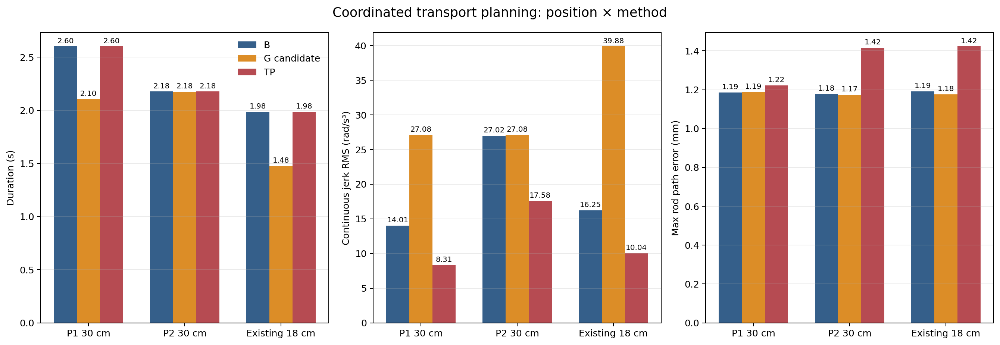

# 2026-10-22 轨迹取舍与柔顺结题结果

本轮按同一 MuJoCo/MoveIt 模型完成 P1、P2 的 30 cm 运输段离线比较，并重算既有 18 cm 长平移样本。所有新规划均从重建的标称抓取/抬升状态开始，保持 5 mm 物体平移网格、≤1°转角网格、同一抓持变换和 `CONTACT_TRANSPORT_STRETCH=1.0`；没有发送机械臂动作。

## S2 位置与方法比较

| 场景 / 方法 | 时长 (s) | 连续 jerk RMS (rad/s³) | 峰值 (rad/s³) | 杆路径最大误差 (mm) | 模型检查 |
|---|---:|---:|---:|---:|---|
| P1 30 cm / B | 2.602 | 14.006 | 238.05 | 1.185 | 通过 |
| P1 30 cm / G 候选 | 2.105 | 27.080 | 452.95 | 1.188 | 通过；最终保留 B |
| P1 30 cm / TP 导出 | 2.602 | 8.315 | 117.72 | 1.223 | 通过；未执行 |
| P2 30 cm / B | 2.177 | 27.016 | 429.58 | 1.178 | 通过 |
| P2 30 cm / G 候选 | 2.176 | 27.078 | 429.58 | 1.174 | 通过；最终保留 B |
| P2 30 cm / TP 导出 | 2.177 | 17.580 | 277.89 | 1.416 | 通过；未执行 |
| 既有 18 cm / B | 1.985 | 16.253 | 281.98 | 1.191 | 通过 |
| 既有 18 cm / G 候选 | 1.478 | 39.881 | 595.48 | 1.176 | 通过；最终保留 B |
| 既有 18 cm / TP 导出 | 1.985 | 10.041 | 172.44 | 1.423 | 通过；未执行 |

jerk RMS/峰值由保存的 q/t/v/a 导出轨迹重建 JTC 使用的分段五次曲线，对每段解析 jerk 作 Gauss 积分；三种方法使用同一计算方式。时间伸缩结果在[机器可读汇总](../../experiment_results/reports/s2_time_tradeoff_20261022/s2_time_tradeoff.csv)中，按 `t*=c`、`v/=c`、`a/=c²` 计算，连续 jerk 按 `1/c³` 变化。`T_common=max(T_B,T_G)`，只拉长较快的轨迹；表中原始 B/G 时长同时保留。

时间剖面优化器内部的同时间连续指标单独报告，避免把轨迹导出插值带来的变化归给时间优化：

| 场景 | 优化器连续 jerk RMS (基线→候选) | 变化 | 最大导出曲线偏差 |
|---|---:|---:|---:|
| P1 30 cm | 14.113→14.010 rad/s³ | −0.73% | 1.118 mrad |
| P2 30 cm | 26.983→27.429 rad/s³ | +1.65% | 2.134 mrad |
| 既有 18 cm | 16.153→14.608 rad/s³ | −9.56% | 2.151 mrad |

**口径修订（2026-10-23）：** 上表是修正前的历史运行结果。旧优化器实际以导出五次插值曲线的 jerk 为 cost，表中的“连续”列只是事后诊断，不能证明修正后的目标收益。新实现已改为直接优化 1 ms 连续 jerk RMS，并增加峰值、约束和忠实导出回退；正式 12 路径离线验收已由用户完成，12/12 候选均被接受，逐次连续 RMS 变化为 −6.57% 至 −3.42%，但仍未执行新候选，不能把上表或新离线降幅写成机械臂执行收益。

### 2026-10-23 R/S 执行结果

在固定 S0 场景完成四次 JTC 完整搬运，顺序为 `R1 → S1 → S2 → R2`。R 的时间倍率为
`1.0`，S 为 `1.2`；四次均 `DONE`，weld/杆约束/attach 关闭，释放和撤退完成。

| 模式 | n | 计划运输时长均值 (s) | 动作墙钟均值 (s) | 释放 XY 误差均值 (mm) | yaw 误差均值 (°) | 杆底面间隙均值 (mm) | 抓取参考残差均值 (mm) |
|---|---:|---:|---:|---:|---:|---:|---:|
| R | 2 | 2.2366 | 2.5412 | 5.75 | 1.12 | 0.592 | 9.53 |
| S | 2 | 2.6787 | 3.2571 | 6.63 | 1.09 | 0.591 | 10.47 |

逐运行数据和对照图：
[`rs_execution.csv`](../../experiment_results/reports/final_tradeoff_20261022/rs_execution/rs_execution.csv)、
[`rs_execution_comparison.png`](../figures/辅助图/02_正常与慢速搬运对照.png)。
最终汇总主图为 [`fig_time_smoothness_final.png`](../figures/结题主图/02_运输时间与平滑度.png)。
S 的计划运输时长单次倍率为 `1.2`，动作墙钟均值增加约 `0.716 s`；每组 n=2，且 R2 受运行开销影响，
不能把该差值全部归因于轨迹。释放 XY 误差在 S 组均值高约 `0.88 mm`，yaw 和底面间隙差异很小，
不足以作精度优劣或统计显著性结论。O 未执行；抓取参考残差不是指垫局部切向滑移的直接测量。

P1 导出 jerk RMS 从 B 的 14.006 降到 TP 导出的 8.315，但旧优化器连续指标只下降 0.73%，且最大曲线导出偏差为 1.118 mrad；因此不能把约 41% 的导出变化都解释为固定几何时间优化收益。P2 同样出现较大的导出 jerk 降幅，但旧优化器连续 jerk 反而增加 1.65%，不作为收益。既有 18 cm 样本的 −9.56% 也仅保留为旧算法历史记录。

几何候选的原始时长较短并不等于轨迹质量更好。统一到 `T_common` 后，P1 的 B/G jerk RMS 为 14.006/14.333，P2 为 27.016/27.040，既有 18 cm 为 16.253/16.472 rad/s³；三个位置均保留 B。其余共同时间下 1.1×、1.2×伸缩曲线见[时间—jerk 图](../figures/历史归档/离线探索/20261022_离线运输时间取舍.png)。

P1 与 P2 的 30 cm 运输段均通过关节限位、速度/加速度、闭链、碰撞和杆路径误差检查。当前 `contact_transport_plan_only` 入口只规划并验证运输段，不验证后续下降/释放撤退；因此本结果只说明运输段可行，不称为整任务可行。鉴于 P1 时间优化收益不清楚、P2 时间优化指标变差，本轮没有启动执行配对，也没有测试 25/20 cm 备选。规划使用的是重建名义状态，不是实测执行起点；不构成执行收益。

尝试目录中的启动/边界失败数据均保留：P1 的沙箱 DDS 权限、ROS 浮点参数类型、起点 y 未对齐和距离边界参数接线问题，以及 P2 首次 12 nm 边界拒绝。最终有效 P1 数据为 `s2_20261022_p1_d30_check3`，P2 为 `s2_20261022_p2_d30_retry`。均为仅规划运行。

## S3 柔顺与承载结果

本轮不改夹持力、刚度或载荷补偿，也没有重复物理仿真。杆重前馈对照使用固定增益 MMC、每臂 `3.1392 N` `J_linear^T F` 前馈和 0.5 s 斜坡，未补偿/补偿各 n=3：名义 3 s HOLD 窗口中杆世界 ΔZ 中位数由 −8.37 mm 变为 −2.90 mm；斜坡后可用的 2.42–2.46 s 窗口内，杆为 −2.27→+0.80 mm，双手由左/右 −1.37/−1.29 mm 变为 +1.78/+1.79 mm。斜坡包含在 3 s 命令内，不另称完整 3 s 静态窗。

启用相同前馈的固定/方向性刚度组在世界 `+X` 总力 2 N、1 s 脉冲下各 n=3。方向性组降低水平 `Kx` 后，杆脉冲结束位移中位数由 1.646 mm 增至 2.318 mm，撤力 3 s 后残余由 0.620 mm 增至 1.120 mm。解释为水平让步增加且残余更大，不称全面抗扰更优。现有力尖峰保留，夹持力稳定性未由本轮数据证实。

复用主图：[杆与双手的载荷前馈 Z 位移](../figures/结题主图/03_载荷补偿减少下沉.png)；[同一前馈下的 2 N、1 s 方向性脉冲响应](../figures/结题主图/04_方向性柔顺与受力让步.png)。后图灰色区间标出施力时间。逐次数据、窗口和误差口径见[扩展场景与载荷补偿记录](S2_S3_扩展场景与载荷补偿_结果_20261020.md)。

## 运行与产物

- S2 分析脚本：[`analyze_s2_time_tradeoff_20261022.py`](../../scripts/analyze_s2_time_tradeoff_20261022.py)
- 机器可读汇总：[`s2_time_tradeoff.csv`](../../experiment_results/reports/s2_time_tradeoff_20261022/s2_time_tradeoff.csv)
- 最终运行原始轨迹：`experiment_results/a1_runs/s2_20261022_p1_d30_check3/`、`experiment_results/a1_runs/s2_20261022_p2_d30_retry/`
- 历史对照：`experiment_results/a1_runs/s2s3_plan_long_20261020/`
- 本轮只构建 `dual_arm_carry_task`，成功；未运行全项目测试、未执行机械臂动作、未提交、未推送。
