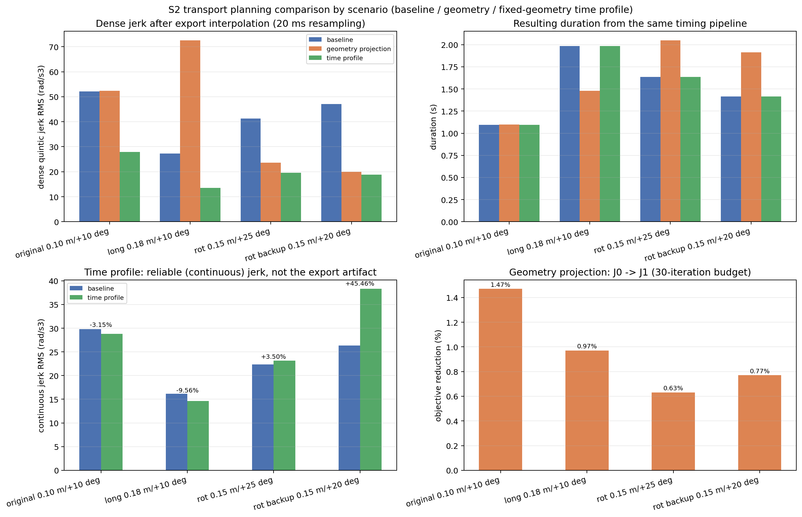
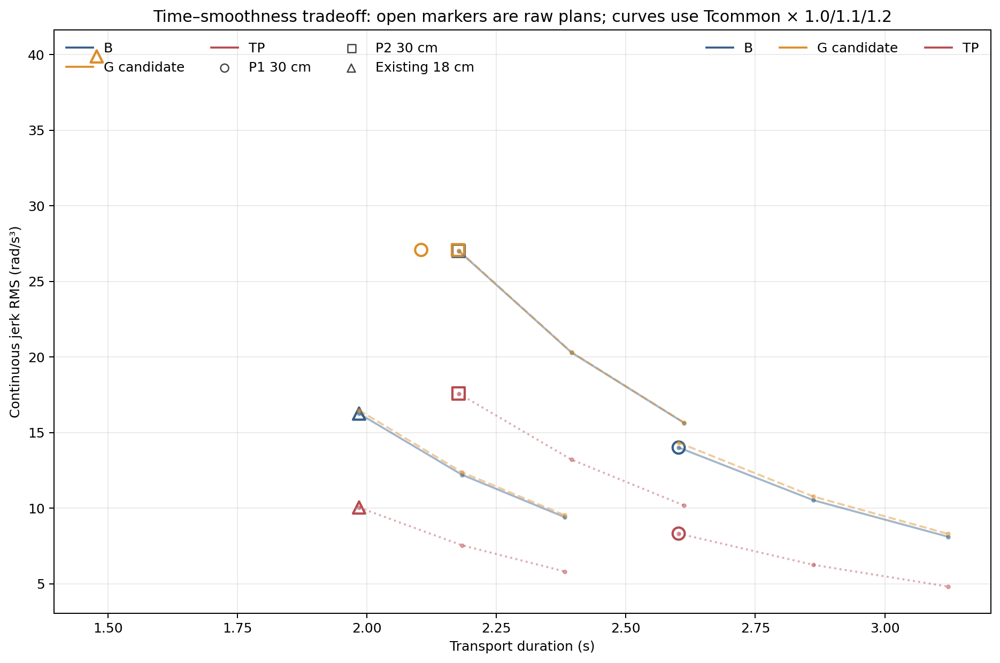
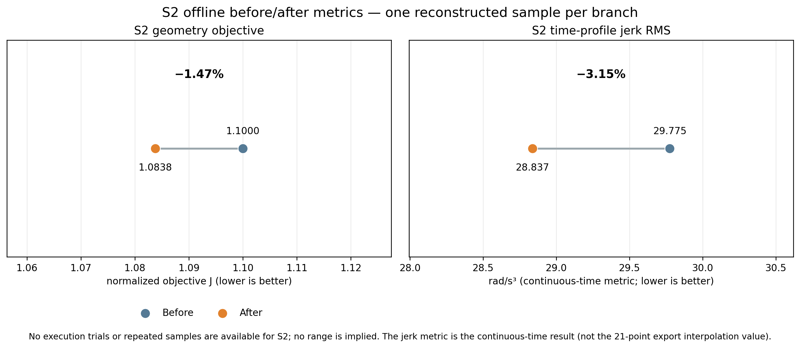
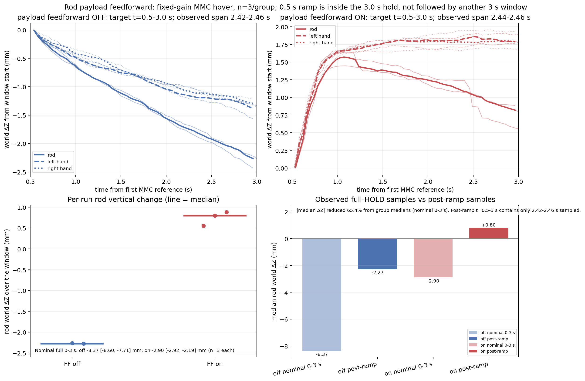
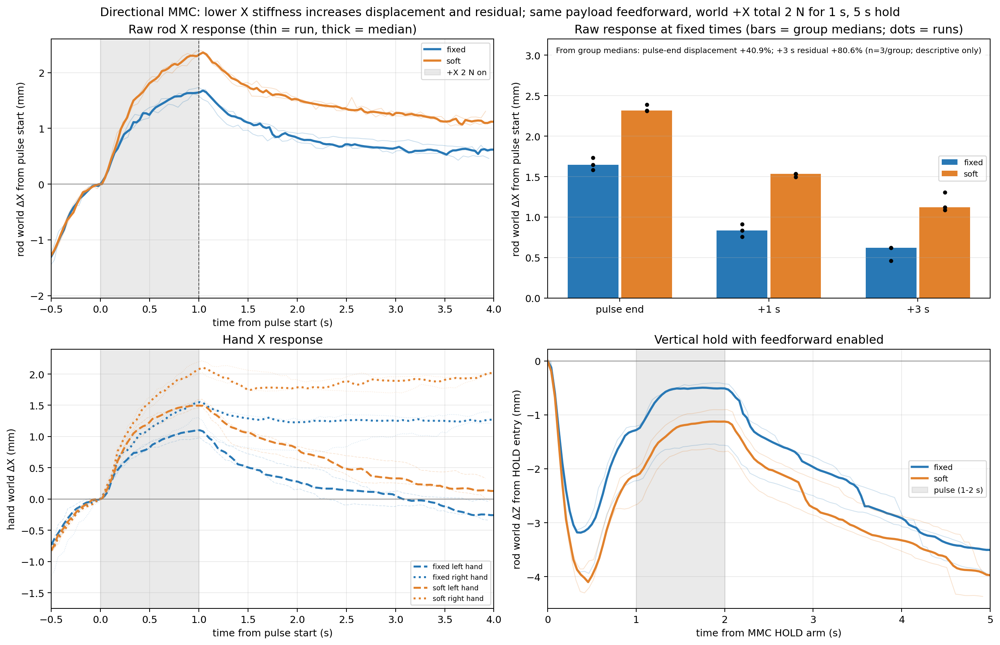
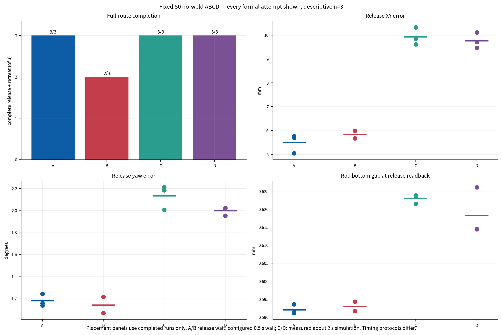
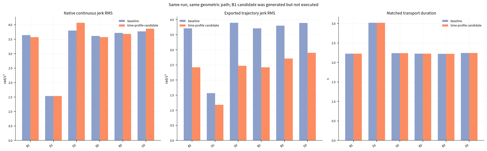
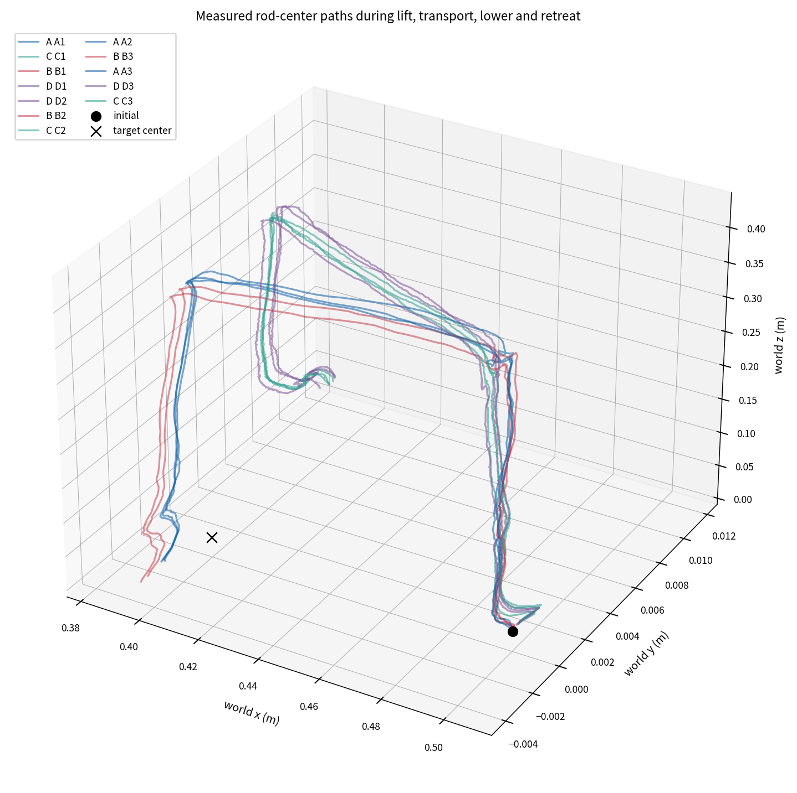

# 基于 Franka 双臂协作的物体搬运轨迹优化与柔顺控制研究

## 结题报告正文（编辑稿）

项目编号：2025F1216  
项目周期：2025 年 11 月—2026 年 11 月  
项目负责人：商喜庆  
学院及专业：未来技术学院 智能装备与系统  
指导教师：刘壮

> 本文是可继续编辑的结题正文草稿，不代替学校正式模板。正文用“已实现”“实验观察”“尚未验证”等文字区分证据层级，定稿时可按学校要求调整格式，但不应合并成未经数据支持的性能结论。项目在仿真中完成，不包含真实机器人试验。

## 摘要

本项目围绕长条物体的双臂协同抓取与搬运，构建了基于 ROS 2、MoveIt 2、ros2_control 和 MuJoCo 的仿真研究平台，研究双臂协调规划、无固定约束的接触抓持、离线轨迹优化及末端阻抗控制。项目以长度 0.40 m 的刚性杆为对象，在固定场景下验证了双臂抓取、抬升、悬空保持、下降和释放流程，并对关节轨迹的几何投影优化、固定几何下的时间剖面优化，以及 JTC 与外部笛卡尔阻抗控制器（MMC）的悬空保持表现进行了有限样本比较。

**2026-10-23 口径修订：** 旧时间剖面优化器的 cost 实际使用导出五次插值曲线 jerk，而正文把连续 jerk 作为主指标；因此本稿中所有修正前的“优化器连续 jerk 收益”只能作为历史诊断。新实现已改为直接使用 `1 ms` 连续 jerk RMS，并增加峰值、约束、忠实导出和最终 `evaluateTransport()` 检查。用户已完成正式 12 路径离线验收：12/12 候选接受并选择，逐次连续 RMS 变化为 −6.57% 至 −3.42%，所有连续峰值均低于同时间基线，导出步长为 5 ms，最大导出偏差约 1.64×10⁻¹³ rad。该结果仍是固定几何、固定原时长的离线候选检查，不等于新候选已执行或产生机械臂性能收益。

修正前离线结果中，几何投影优化目标在一个重建样本上下降约 1.47%；旧时间剖面报告的场景变化从 −9.56% 到 +45.46% 不等。2026-10-22 的 P1/P2 旧结果中，P1 诊断连续 jerk 仅下降 0.73%，P2 增加 1.65%，均未形成清楚的新执行收益，因此没有开展执行配对。载荷补偿和方向性脉冲结果仍限于既有悬空保持样本：前馈对照各 3 次，3 s 保持命令窗口内杆世界 ΔZ 的组中位数由 −8.37 mm 变为 −2.90 mm，斜坡后可用采样约 2.42–2.46 s；方向性 `Kx=200 N/m` 组在相同前馈下的 2 N、1 s 水平脉冲结束位移中位数比固定增益组高约 40.9%，撤力 3 s 后残余高约 80.6%。这表示更多让步伴随更大残余，不构成统计显著或抗扰优势结论。

此外，当天固定 S0 的无 weld A/B/C/D 对照各尝试 3 次：A/C/D 均 3/3 到达释放与撤退，B 为 2/3；B1 在运输下发前被初版起点连接入口上限拒绝。成功样本的平均释放 XY 误差 A/B/C/D 为 5.50/5.83/9.93/9.77 mm，平均绝对 yaw 误差为 1.18/1.14/2.13/2.00°。B2/B3 同路径原生连续 jerk RMS 按逐次平均下降 1.10%；D 三次逐次平均上升 3.05%，均值之比为 3.88%。两组导出 RMS 的逐次平均变化分别为 −31.75% 和 −28.89%，但时间剖面未缩短运输计划，求解耗时 B 为 2.57–2.62 s、D 为 2.63–3.55 s。C/D 同时启用了阻抗与载荷前馈，不能将差异单独归因于阻抗。所有结果限于单一场景和每组 3 次，不能作统计显著或普遍性能结论。

**关键词：** 双臂协作；接触抓持；轨迹优化；笛卡尔阻抗；MuJoCo 仿真

## 1 研究问题与范围

长条物体由两台机械臂共同抓持时，双手运动需要保持协调，接触约束又会使两侧的运动和受力相互影响。轨迹的几何与时间参数化会影响执行平滑性；控制器的刚度和阻尼会影响保持期间的位姿变化与承载表现。本项目据此关注三个问题：如何在仿真任务中组织双臂协同运动；如何在不把杆焊接到手上的条件下建立并保持真实接触抓持；以及有限的轨迹优化和阻抗控制变化在现有实验条件下表现出什么效果。

中期报告提出了更广泛的目标，包括 CHOMP、等时参数化、力位混合/自适应柔顺、扰动恢复及部分实机验证。本项目后续将验证范围调整为仅在 MuJoCo 中开展。结题时按实际实现和数据报告：已完成的功能链、实际观察到的数值结果，以及仍未验证的原定目标分别说明，不把中期计划当作已达成结果。

仿真平台采用 ROS 2 Humble、MoveIt 2、ros2_control 和 MuJoCo，双臂为 Franka Panda 模型。主要悬空实验在固定杆初始场景 `(0.50, 0.00, +10°)` 下完成，杆为刚体；抓持请求为每指 10 N，自适应夹持关闭，杆与夹爪之间不启用 weld 或杆固定约束。杆几何尺寸为 `0.40 × 0.04 × 0.04 m`；当前模型质量约为 `0.64 kg`，与中期报告中的目标质量 `0.5 kg` 不同，因此结果只适用于记录中的实际模型参数。主要控制实验采用 JTC 抬升 50 mm 的命令及约 3 s 的悬空保持窗口。

本报告将无 weld 悬空保持和完整搬运分开报告。当天固定 S0 的 A/C/D 各三次、B 两次完成了 40 cm 抬升、约 0.10 m 运输/旋转、下降、释放与撤退；另一次 B 在运输前失败。随机初始场景泛化和真实机械臂试验不在已完成验证范围内。

## 2 方法与系统实现

### 2.1 双臂协调规划

**已实现：** 任务程序将双臂运动组织为可执行的分阶段流程，并使用物体位姿与两侧固定抓取变换建立双臂目标关系。接近和部分抓取动作使用 MoveIt/Pilz PTP；接触运输链路通过物体路径采样、双臂逆运动学和 IPTP 生成关节轨迹，并进行关节限位、碰撞、速度、加速度和双手/物体参考一致性检查。该流程提供了任务级协调规划和仿真执行能力。

**尚未验证：** MoveIt 配置中注册了 CHOMP，不代表主任务链路默认完成 CHOMP 闭链优化。现有接触运输主链以 IK 与 IPTP 为主；另有一次 CHOMP 规划分支测试，但没有显式纳入双臂闭链约束，故不作为本项目已验证的双臂闭链优化成果。本文所称“双臂协调规划”指当前已接入并验证的物体路径、固定抓取关系、双臂 IK 和轨迹检查流程，不声称已经实现中期报告所设想的全局最优规划。

### 2.2 真实接触抓持

**已实现：** 抓持实验通过 MuJoCo 中的手指接触和摩擦承载杆，不使用手—杆 weld 或杆固定约束。任务执行包括预抓取、下降、夹爪闭合、双侧接触判据、JTC 抬升、保持、下降和释放。抬升后使用杆的物理真值及其最低点与支撑面关系判断离台；该判据用于悬空保持研究入口，不以手部高度或规划目标替代杆真值。

**已实现：** 固定场景下完成无 weld 的抓取、抬升和释放；JTC/MMC 对照及短脉冲组各自均完成规定的悬空保持、正常控制器回切、下降和释放流程。  
**实验观察：** 闭合后原抓取参考下的残差会变化；该量是由手位姿与原抓取变换推得的抓取参考残差，不是直接测得的指垫切向滑移。杆中心与手部位置的相对变化也不能单独解释为接触点滑移。

### 2.3 离线轨迹优化

**实验观察：** 项目对固定场景中重建的离线规划样本开展了两个彼此独立的 S2 分支分析。

几何投影优化对内部关节航点进行调整，在固定端点和物体参考路径下，以几何平滑相关目标为优化量，并在模型侧检查双手参考、碰撞、关节限位、速度和加速度。单个重建样本的目标函数由 1.100000 降至 1.083785，约下降 1.47%。该指标不是时间 jerk、执行时间、接触力或能耗；样本标记为离线重建，未执行搬运。

修正前的时间剖面优化固定几何路径和总时长，仅调整时间映射。原场景单样本记录的连续时间关节 jerk RMS 从 29.775 降至 28.837 rad/s³，约下降 3.15%；201 点稠密导出得到约 3.16% 的变化。按旧基线21点网格导出时，插值后的 jerk RMS 看起来下降约 36.7%，但候选导出相对其连续候选曲线偏离最大 2.13 mrad；网格改变后该大幅降幅消失，因此将其作为导出插值影响，不作为连续运动改善。扩展场景中，旧时间剖面连续 jerk 既有改善也有变差。模型侧可行性检查通过，但没有优化候选的完整执行配对；未证明执行收益。

轨迹指标应分层理解：几何优化的 `J` 目标下降是目标函数变化；连续 jerk RMS 是时间映射的连续轨迹指标；稀疏导出后的插值 jerk 还受导出与控制器插值表示影响；实际执行收益则需要成功的同条件执行配对。本项目没有完成扩展轨迹的完整下降与释放，故不把规划可行或中途运输称为完整配对通过。候选不会自动替代默认基线；默认生产路径保留原基线轨迹，优化候选仅用于离线比较或明确启用的实验配对，基线回退保持可用。

### 2.4 阻抗控制

**已实现：** JTC 使用关节轨迹控制器完成抓取后的抬升和下降。MMC 使用控制器各自 link0 坐标中的末端位姿、零速度和冗余关节参考，在已抬升状态下执行静止 HOLD；控制器切换采用严格互斥，并通过状态和首参考接收确认链路。悬空保护和故障退出逻辑在保持期间运行。本文报告的 MMC 实验只覆盖静止 HOLD，不覆盖 MMC 执行抬升、运输或扰动恢复闭环任务。

方向性组只降低两臂各自 link0 坐标中的水平 `X` 平移刚度，保持竖直与姿态参数、阻尼设计方法及其他控制设置不变；两臂 link0 的方向设置使该轴对应相同的世界 `+X`。本项目保留两种不同的扰动结果：早期无载荷前馈的短脉冲为世界 `+X` 总力 2 N、0.2 s；新增主要对照在相同杆重前馈下施加世界 `+X` 总力 2 N、1.0 s，MMC 总保持 5.0 s，脉冲于保持开始后 1.0 s 开始。两种脉冲均作用于杆质心、不额外施加力矩，不能混作同一条件。

## 3 实验结果

### 3.1 S2 离线优化

| 分支与指标 | 基线 | 优化后 | 变化 | 数据性质 |
|---|---:|---:|---:|---|
| 几何投影目标函数 | 1.100000 | 1.083785 | −1.47% | 单个重建离线样本，未执行 |
| 连续时间 jerk RMS | 29.775 rad/s³ | 28.837 rad/s³ | −3.15% | 固定几何、固定时长的离线时间映射 |

两项结果均表明优化器在对应样本和预算下产生了数值变化，并通过已有模型侧约束检查；数据没有证明任务执行更快、更平滑或更准确。几何优化仍使用重建样本，时间剖面样本也不是实际搬运的测量轨迹，因此不把两分支合并成一次执行收益。

扩展规划样本的四场景结果见[轨迹对照主图](../figures/s2s3_extended_20261020/transport_plan_comparison.png)。几何投影目标下降 0.63–1.47%，但不代表 jerk 或执行改善；固定几何时间剖面的连续 jerk RMS 变化为 −3.15%、−9.56%、+3.50% 和 +45.46%。21 点导出插值造成的较大 jerk 降幅与连续指标分开报告；扩展轨迹执行配对未完成下降/释放，候选没有获得可报告的完整执行收益。默认路径保留基线，不自动选择变差候选。

图 2  四场景的规划指标。目标函数、连续 jerk、派发形式采样 jerk 和时长是不同量；规划图不表示完成了实际执行配对。

扩展运输执行共 4 次尝试，均没有完整下降与释放：两次在运动前受配对规划起点漂移/真值请求超时阻断；另两次基线轨迹完成运输后，运输末端实测状态出现左臂 `link2↔link5` 自碰撞，`lower` 规划拒绝。没有候选轨迹完成执行配对，不能将中途运输计为完整配对通过。配对规划与评估的 2–3 s 墙钟窗口也未保持原 50 ms 监测循环，这是该实验路径的限制；本报告不继续尝试修复或重跑该运输场景。

2026-10-22 的 P1 `(0.50,+0.02)→(0.20,+0.02)` 和 P2 `(0.52,−0.02)→(0.22,−0.02)` 均完成 30 cm 运输段离线规划比较，基线与几何候选在模型侧均通过。以下为修正前旧优化器的历史结果：连续 jerk 使用保存的 q/t/v/a 轨迹重建五次控制器插值曲线，并对 B/G/TP 使用相同积分口径。P1 的 B/G 时长为 2.602/2.105 s，统一至 2.602 s 后 jerk RMS 为 14.006/14.333 rad/s³；P2 时长为 2.177/2.176 s，jerk RMS 为 27.016/27.040 rad/s³，因此几何分支两处均保留基线。旧 TP 优化器诊断连续指标在 P1 下降 0.73%，在 P2 上升 1.65%；导出轨迹的 jerk 降幅更大，但最大导出曲线偏差为 1.118/2.134 mrad，不把该差异全部归于固定几何时间优化。由于旧 P1 收益不清楚、P2 无收益，本轮未开展执行配对。此入口只验证运输段，未验证后续下降/释放撤退；这些位置不称为完整任务可行。

图 7  三种方法的时长、统一计算的导出曲线连续 jerk RMS 和杆路径最大误差。TP 内部连续优化器指标另列于[当日结果](20261022_轨迹取舍与柔顺结题_结果.md)，以区分导出曲线表示误差。

图 8  空心符号为原始规划；折线为统一到 `T_common` 后的 1.0/1.1/1.2 倍时间伸缩计算值。时间、速度和加速度同步缩放，jerk 按 `1/c³` 变化。逐方法数据见[机器可读汇总](../../experiment_results/reports/s2_time_tradeoff_20261022/s2_time_tradeoff.csv)。

图 1  S2 离线样本指标。该图展示单样本数值变化，不代表重复实验分布或执行收益。

### 3.2 JTC 与 MMC 无扰动悬空保持

在相同固定场景、模型、抓持参数和保护条件下，JTC 与 MMC 各有 3 次有效运行。各次均完成 3 s 目标保持、回切/持续 JTC、下降和释放。实际采样窗口约为 2.92–3.00 s，表内报告按各自窗口入口对齐的杆世界位移。

| 指标 | JTC，n=3 | MMC，n=3 |
|---|---:|---:|
| 杆世界 ΔZ 范围 | −1.49 至 +0.72 mm | −8.87 至 −7.76 mm |
| 杆世界 ΔZ 中位数 | −0.25 mm | −8.48 mm |
| 左/右手世界 ΔZ 范围 | 左 −0.79 至 +0.81 mm；右 −0.29 至 +1.07 mm | 左 −7.55 至 −6.85 mm；右 −6.58 至 −6.02 mm |
| 最大杆姿态变化范围 | 0.40–0.55° | 0.33–0.44° |
| 流程完成 | 3/3 | 3/3 |

图 3  每次运行按自身保持入口对齐的杆与双手世界坐标 ΔZ。MMC 组杆与双手均明显下降，故杆的世界下沉不能全部归结为杆相对手的运动或接触滑移。样本仅用于描述本次条件下的表现。

抓取参考残差图及逐次结果见 [图表与 A/B 记录](../CONTACT_HOVER_AB_COMPARISON_20261020.md)。该记录同时报告 HOLD 入口状态、保持末端状态和新增变化，避免仅用累计残差比较不同的入口状态。

### 3.3 历史固定与方向性 MMC 短脉冲（无杆重前馈）

该历史对照保留为早期条件，不与新增长脉冲组混合：固定增益组与方向性组各完成 3 次；每次在 MMC HOLD 开始约 1 s 后，对杆质心施加世界 `+X` 方向总力 2 N、持续 0.2 s。脉冲事件记录了实际施力起止。两组杆在整个 HOLD 期间的世界竖直位移中位数分别约为 −7.99 mm 和 −8.58 mm；方向性组没有减小整体下沉。

| 指标 | 固定增益 | 方向性 `Kx=200 N/m` |
|---|---:|---:|
| 杆 HOLD 世界 ΔZ 中位数 | −7.988 mm | −8.575 mm |
| 杆世界 ΔX：脉冲结束中位数 | 1.125 mm | 1.054 mm |
| 杆世界 ΔX：脉冲结束后 1 s 中位数 | 1.060 mm | 1.089 mm |
| 完成保持、回切、下降和释放 | 3/3 | 3/3 |

图 4  以实际施力事件对齐的原始杆与双手水平响应。曲线包含保持期背景漂移，不能将全部位移归因于外力。

脉冲前局部线性去趋势估计与原始响应图见 [补充去趋势图](../../experiment_results/reports/hover_directional_perturbation_20261020/mmc_directional_pulse_detrended.png)。该估计假定脉冲前短时间段拟合出的漂移在脉冲后继续，只用于敏感性参考；由于该假设没有无扰动同期轨迹支撑，不称为净外力响应，也不据此计算恢复时间。三个方向性样本没有相对于固定组呈现清晰且一致的位移或恢复优势。

### 3.4 杆重前馈下的 MMC 悬空保持（新增主要结果）

该实验对照杆重前馈关闭/开启，固定增益和接触条件不变，每组 3 次。控制器前馈按模型杆质量 0.64 kg 均分为每臂 3.1392 N，并在仿真时间 0.5 s 内从零斜坡至目标；前馈默认关闭，力矩在既有限幅路径内叠加，不向杆状态直接施力。每次从 MMC 首参考确认时刻起，HOLD 命令总时长为 3.0 s，斜坡处于该 3 s 窗口内。

每次运行从首参考开始的完整 HOLD 采样区间约 2.92–2.98 s；斜坡后目标采样区间为相对首参考 `0.5–3.0 s`，但实际首末样本跨度只有 2.42–2.46 s，不能写成“斜坡后再保持完整 3 s”。下表中的 ΔZ 均为该区间首末实际样本之差；所有六次均完成 HOLD、回切、下降与释放。

| 组 | run | 完整窗首末采样 (s) | 杆 ΔZ 完整窗 (mm) | 斜坡后首末采样 (s) | 实际斜坡后样本跨度 (s) | 杆 ΔZ 斜坡后 (mm) |
|---|---|---:|---:|---:|---:|---:|
| FF off | `s2s3_ff_off_01` | 0.038–2.958 | −8.60 | 0.536–2.958 | 2.422 | −2.43 |
| FF off | `s2s3_ff_off_02` | 0.040–2.960 | −7.71 | 0.540–2.960 | 2.420 | −2.27 |
| FF off | `s2s3_ff_off_03` | 0.036–3.000 | −8.37 | 0.536–3.000 | 2.464 | −2.27 |
| FF on | `s2s3_ff_on_01_retry1` | 0.020–2.998 | −2.92 | 0.538–2.998 | 2.460 | +0.56 |
| FF on | `s2s3_ff_on_02` | 0.016–2.996 | −2.90 | 0.536–2.996 | 2.460 | +0.80 |
| FF on | `s2s3_ff_on_03` | 0.020–2.962 | −2.19 | 0.522–2.962 | 2.440 | +0.89 |

| 指标（中位数 [范围]，n=3） | 未补偿 | 杆重前馈 |
|---|---:|---:|
| 杆世界 ΔZ，完整 HOLD 实际采样窗 | −8.37 [−8.60, −7.71] mm | −2.90 [−2.92, −2.19] mm |
| 杆世界 ΔZ，斜坡后可用采样窗 | −2.27 [−2.43, −2.27] mm | +0.80 [+0.56, +0.89] mm |
| 左手 / 右手 ΔZ，斜坡后窗 | −1.37 / −1.29 mm | +1.78 / +1.79 mm |
| 杆−手相对位置变化模长 L / R，斜坡后窗 | 3.70 / 3.74 mm | 3.11 / 4.74 mm |
| 抓取参考残差增量 L / R | +4.09 / +4.65 mm | +4.01 / +5.29 mm |
| 杆姿态变化，斜坡后窗 | 0.342° | 0.307° |
| MMC 跟踪误差中位数，斜坡后窗 | 6.64 mm | 2.93 mm |
| 完成 HOLD/回切/释放 | 3/3 | 3/3 |

按组中位数的绝对竖直位移计算，前馈组完整窗沉降幅值比未补偿组低约 65.4%：`(8.37−2.90)/8.37`。该百分比由两个组中位数计算，不是逐次百分比的平均，也不表示统计显著。斜坡后杆由中位数下降约 2.27 mm 转为上升约 0.80 mm；左右手也小幅上升。与此同时，杆−手相对位置变化没有一致改善，抓取参考残差增量也接近、右侧略高。结果支持“当前窗口内整体竖向沉降减少”，不支持“接触滑移消除”。

图 5  细线/散点为每次运行，粗线/短横线为组中位数。完整 HOLD 约 3 s；图中 `0.5–3.0 s` 是前馈斜坡后可用区间，实际观测跨度约 2.42–2.46 s，不是额外的完整 3 s。

### 3.5 启用前馈后的方向性长脉冲

固定组 `K=(400,400,400) N/m`，方向性组 `Kx=200, Ky=Kz=400 N/m`；姿态刚度、阻尼设计、零空间及杆重前馈保持一致。每次 MMC HOLD 5 s，开始后 1 s 对杆质心施加 world `+X` 总力 2 N、持续 1 s，随后撤力并观察至 HOLD 结束。事件日志确认各次实际施力均为 1.0 s；每组 n=3，全部完成 HOLD、回切、下降与释放。脉冲结束后 +1 s/+3 s 指相对脉冲结束时刻。

| 组 | run | 杆 ΔX 脉冲结束 (mm) | 杆 ΔX 撤力 +1 s (mm) | 杆 ΔX 撤力 +3 s (mm) | HOLD 杆 ΔZ (mm) | 抓取参考残差增量 L/R (mm) |
|---|---|---:|---:|---:|---:|---:|
| 固定 | `s2s3_dir_fixed_01` | 1.581 | 0.759 | 0.620 | −3.493 | +9.049 / +9.537 |
| 固定 | `s2s3_dir_fixed_02` | 1.646 | 0.833 | 0.461 | −3.928 | +6.881 / +8.739 |
| 固定 | `s2s3_dir_fixed_03` | 1.735 | 0.911 | 0.623 | −3.503 | +6.643 / +6.817 |
| 方向性 | `s2s3_dir_soft_01_retry1` | 2.318 | 1.536 | 1.308 | −4.366 | +6.051 / +8.016 |
| 方向性 | `s2s3_dir_soft_02` | 2.391 | 1.533 | 1.089 | −3.972 | +8.184 / +9.336 |
| 方向性 | `s2s3_dir_soft_03` | 2.311 | 1.495 | 1.120 | −3.940 | +8.680 / +9.305 |

| 指标（组中位数 [范围]，n=3） | 固定增益 | 方向性 `Kx=200` |
|---|---:|---:|
| 杆 ΔX 脉冲结束 | 1.646 [1.581, 1.735] mm | 2.318 [2.311, 2.391] mm |
| 杆 ΔX 撤力 +1 s | 0.833 [0.759, 0.911] mm | 1.533 [1.495, 1.536] mm |
| 杆 ΔX 撤力 +3 s 残余 | 0.620 [0.461, 0.623] mm | 1.120 [1.089, 1.308] mm |
| HOLD 杆世界 ΔZ，约 5 s | −3.503 [−3.928, −3.493] mm | −3.972 [−4.366, −3.940] mm |
| 抓取参考残差增量 L / R 中位数 | +6.881 / +8.739 mm | +8.184 / +9.305 mm |
| 完成 HOLD/回切/下降/释放 | 3/3 | 3/3 |

方向性组较固定组的脉冲结束位移组中位数高约 40.9%，撤力 +3 s 的杆位移残余组中位数高约 80.6%；两个百分比均按相应组中位数计算，只作 n=3 的描述性比较。方向性刚度降低带来更大水平让步，但撤力 3 s 后仍有更大残余；杆抓取参考残差增量的左右中位数也较高。两组竖直刚度相同，方向性组竖直沉降幅值略大（约 3.97 mm 对 3.50 mm）。该结果呈现“增加柔顺让步但残余更大”的权衡，不表示统计显著或抗扰优势；两组在观测结束时都未回到脉冲前位置，不计算恢复时间。

图 6  原始杆与双手水平位移按实际脉冲开始对齐；浅色线/散点为逐次运行，柱/粗线为组中位数。方向性组的位移和 +3 s 残余更大。去趋势辅助图见 [补充图](../figures/s2s3_extended_20261020/directional_pulse_detrended.png)；由于脉冲后局部线性漂移假设不成立，不以其替代原始曲线或计算净外力响应。

### 3.6 固定 S0 的无 weld 完整搬运 A/B/C/D 运行

用户为结题展示选择同一固定场景：杆从 `(0.50,0,+10°)` 运输至 `(0.40,0,+20°)`（世界绝对 yaw）。当天批次按 `A1→C1→B1→D1→D2→B2→C2→A2→B3→A3→D3→C3` 完成 12 次尝试；A 为基础轨迹+JTC，B 为时间剖面优化轨迹+JTC，C 为基础轨迹+独立笛卡尔阻抗 MMC，D 为优化轨迹+同一 MMC。C/D 同时使用 0.64 kg 杆载荷前馈，因此代表“阻抗+载荷补偿”组合。四组共用真实接触抓持、40 cm 抬升、水平运输及旋转、支撑下降、松爪与 15 cm 撤退，weld/attach 关闭。新增修复/验证动作共 2 次；本任务实际动作共 14/15，基础设施启动失败没有机械臂动作；前一批 39 次历史独立保留。

| 组 | 完整到达释放与撤退 | 释放位置误差均值（范围） | 绝对 yaw 误差均值（范围） |
|---|---:|---:|---:|
| A：基础轨迹 + JTC | 3/3 | 5.50 mm（5.04–5.76） | 1.18°（1.13–1.24） |
| B：时间剖面优化 + JTC | 2/3 | 5.83 mm（5.67–5.99，仅成功两次） | 1.14°（1.06–1.21，仅成功两次） |
| C：基础轨迹 + MMC/载荷前馈 | 3/3 | 9.93 mm（9.62–10.33） | 2.13°（2.00–2.21） |
| D：优化轨迹 + MMC/载荷前馈 | 3/3 | 9.77 mm（9.47–10.11） | 2.00°（1.95–2.02） |

B1 的优化候选生成成功，但实测起点差 5.318 mrad 超过当时新加的 5 mrad 连接入口上限，因此在实际运输前停止；优化候选并未下发。保留失败目录，不能把 B1 候选指标称为执行收益。后续 B 验证和 B2/B3 使用 12 mrad 有界连接入口，实际消息仍从实测起点开始连接，保持原 2 mrad 下发一致性检查；连接逐点进行原有关节限值、闭链残差和碰撞检查。相关版本边界在逐次 CSV 中记录。

B2/B3 同路径原生连续 jerk RMS 按逐次相对自身基线平均下降 1.10%，导出 jerk RMS 平均下降 31.75%；B 的全部候选含未执行的 B1 时逐次平均变化为 −1.36%。D 三次原生连续 RMS 的逐次平均变化为 +3.05%，旧“均值之比”口径为 +3.88%；导出 RMS 逐次平均下降 28.89%，均值之比为 −29.92%。时间剖面优化保持基线的运输计划总时长，并未缩短计划运动；B 求解耗时 2.57–2.62 s，D 为 2.63–3.55 s。接触阶段至终态的均值 A/B/C/D 为 21.79/24.94/26.88/29.69 s；B 仅对两次成功运行求均值。轨迹优化增加的规划计算时间影响任务耗时，导出 jerk 变化也需结合导出位置偏差解读。

释放 XY 误差分别为 5.50/5.83/9.93/9.77 mm。按物理支撑面 `z=0` 修订后，完整成功运行的杆底面间隙均值约 0.592/0.593/0.623/0.618 mm；旧版把 `0.000654 m` 沉降偏置误作支撑高度，导致底隙少算 0.654 mm。A/B 使用配置的 0.5 s 墙钟等待，C/D 使用实测约 2.0 s 仿真等待，因此不据底隙作跨组同等待时刻优劣判断。A 的释放 XY/yaw 误差较低；C/D 的释放 XY/yaw 误差和抓取参考残差较高。C/D 的差异含阻抗与载荷前馈两项变化，不是单因素柔顺控制对照。三次/组和单一场景只支持描述性结论。

图 9–11 分别为完成/落放、同路径优化指标和运行期杆中心空间轨迹。修订后逐次数据见[正式 CSV](../../experiment_results/reports/final_tradeoff_20261022/abcd_s0_formal_runs.csv)、[组汇总 CSV](../../experiment_results/reports/final_tradeoff_20261022/abcd_s0_group_summary.csv)、[B 验证 CSV](../../experiment_results/reports/final_tradeoff_20261022/abcd_s0_validation_runs.csv)和[离线分析脚本](../../scripts/analyze_abcd_s0_today.py)。旧版汇总与图保留在原目录；原始目录为 `experiment_results/a1_runs/abcd_s0_today_*_20261022_*/`，旧 39 次结果单独保留。

## 4 讨论

### 4.1 优化收益的范围

S2 的 1.47% 几何目标下降和约 3.15% 连续时间 jerk RMS 下降来自离线重建样本。修正前旧优化器的当天固定 S0 B2/B3 连续 jerk RMS 按逐次平均下降约 1.10%，D 三次逐次平均上升约 3.05%；这些只能作为历史记录。修正后正式 12 路径离线检查中 12/12 候选接受并选择，逐次连续 RMS 变化为 −6.57% 至 −3.42%，所有峰值低于同时间基线；但新候选没有执行，且该比较仍使用各自基础路径和原运输时长。优化收益依赖控制组、轨迹表达与指标口径，不支持总体优越性、跟踪精度或能耗结论。B1 未执行运输；其离线候选接受不计入执行收益。三次/组的有限样本不能证明统计显著，也没有证明 CHOMP 主链收益。

2026-10-23 的 R/S 四次完整 JTC 执行进一步提供了有限执行对照：R 两次与 S 两次均完成释放和撤退，计划运输时长均值分别为 `2.2366/2.6787 s`，动作墙钟均值分别为 `2.5412/3.2571 s`，释放 XY 误差均值分别为 `5.75/6.63 mm`，杆底面间隙均值分别为 `0.592/0.591 mm`。S 的计划时长倍率为 1.2，但每组只有两次，且动作墙钟包含运行开销；因此这些结果只作描述性时间—平滑取舍证据，不能作统计显著性或纯轨迹因果结论。O 因离线 gate 未通过而未执行。

### 4.2 刚性跟踪与柔顺让步

在悬空保持实验中，JTC 的杆世界高度变化较小，固定增益 MMC 组下沉更多；杆重前馈减小了 MMC 的整体竖向沉降。当天固定 S0 完整搬运中，A/B/C/D 完成数为 3/2/3/3；A/B 成功组释放 XY/yaw 误差低于 C/D。修订后完整成功运行的杆底面间隙约 0.59–0.62 mm，但 A/B 与 C/D 的释放等待协议不同，不据底隙作跨组同等待时刻结论。C/D 还使用了杆载荷前馈，所以当前对照呈现的是刚性基线与“阻抗+前馈”组合间的表现差别，不能拆成阻抗算法的单独效果。杆相对于双手的变化、抓取参考残差和杆的世界位移是不同指标，应分开解释。

方向性实验只改变水平 `X` 刚度而保留竖直参数，因此不能用它解释或改善本轮观察到的整体竖直沉降。短时脉冲的原始水平曲线受背景漂移影响，去趋势估计也依赖局部线性外推假设。两组小样本没有呈现明确优势，既不说明方向性设计在其他条件下一定无效，也不支持其具有抗扰优势。

早期悬空保持实验没有对杆载荷进行额外的竖直前馈补偿，因此当时观察到的整体下沉可能与控制目标、负载和系统动力学共同有关；仅凭简化静态估算无法确定根因。完整搬运 C/D 后续沿用已有载荷前馈。当前结果应作为有限场景下的对照，而不应外推成普遍规律。

2026-10-20 扩展轮在同一 MMC 悬空入口上加入固定均分杆重前馈，固定增益组的 3 s 杆世界 ΔZ 中位数由 −8.37 mm 降至 −2.90 mm，表明前馈在当前测试条件下减少了整体沉降；这不证明载荷补偿是原始下沉的唯一根因。结论限定于当前 0.64 kg 模型、均分假设、固定夹持和约 2.42–2.46 s 的斜坡后采样窗，也不代表前馈可消除所有残余变化。启用同一前馈后，方向性水平刚度组在 2 N、1 s 脉冲下呈现更大的 X 向让步和更大残余，符合降低该方向刚度后的权衡；这仍只是每组 3 次样本的描述性结果。

## 5 局限与尚未验证目标

1. **样本有限。** S2 每个分支为一个重建离线样本；悬空保持和脉冲对照各为每组 3 次。当天固定场景完整搬运 A/B/C/D 各尝试 3 次，完整完成数为 3/2/3/3。仅报告逐次结果、范围和均值，不作统计显著性或普遍成功率推断。
2. **场景固定。** S3 主要结果来自 `(0.50, 0.00, +10°)` 固定场景与同一仿真模型，未覆盖随机起点、质量/摩擦变化或广泛工况。
3. **测量异步。** 杆真值、左右手状态和接触反馈以有限频率采样，左右时间差最高约 16–26 ms。相对位姿指标来自异步快照，不能解释成同一物理步的精确力平衡或连续接触证明。
4. **有一次 B 组未执行运输。** 固定 S0 下 A/C/D 各 3 次完成释放和撤退，B 两次完成、一次在运输前被初版起点连接入口上限拒绝；失败原始数据保留，B1 候选不作为执行收益。其余运行沿用用户确认的 5°/20 mm 条件。接线修复前后记录了连接入口范围版本；原 2 mrad 消息起点检查及现有碰撞、掉落、力矩保护没有放宽。该小样本不代表真实硬件安全恢复能力。
5. **接触滑移未直接测量。** 抓取参考残差是由手位姿推算的杆中心参考量，杆—手位置变化是相对位姿量，两者都不是指垫局部切向滑移的直接测量。
6. **模型范围。** 结果受当前刚体几何、约 0.64 kg 模型质量、接触与摩擦参数、夹持设置和 MuJoCo 求解条件限制；没有真实机械臂或实物数据验证仿真到现实迁移。
7. **中期预期指标未全部验证。** 受力差波动、扰动恢复时间、时间缩短、能耗代理改善、随机场景成功率、完整任务精度和实机测试不作为已完成结论。现有实验也没有证明显著性能提升或抗扰优势。
8. **扩展运输场景未完整执行。** 0.18 m/+10°、0.15 m/+25° 及 +20° 备选完成了仅规划比较；0.15 m/+25° 与 +20° 备选的运输执行尝试在到达目标区后出现左臂 `link2↔link5` 自碰撞，未完成下降/释放，因此没有扩展场景的完整执行配对或放置误差。配对规划/评估还造成约 2–3 s 监测窗口缺口。实验配对路径的 10 mrad 起点容差仅由显式 `CONTACT_TRANSPORT_PAIRING` 启用；默认路径仍为 2 mrad。本轮不继续修复或尝试该运输场景。
9. **前馈的固定假设与窗口。** 每臂按杆重一半、固定 0.64 kg、单位基座旋转施加 `J^T F`，不补偿力矩、不做自适应分配；0.5 s 斜坡包含在 3 s HOLD 请求内，斜坡后实际样本跨度约 2.42–2.46 s。前馈减少的是本窗口整体竖向沉降，抓取参考残差未显示同幅度改善。
10. **方向性长脉冲仍为小样本。** 每组 3 次、固定 2 N/1 s 脉冲和 5 s 保持；原始 X 曲线含背景漂移，去趋势线性外推在脉冲后不成立。可报告描述性让步与残余，不作显著性、恢复时间或鲁棒性结论。

## 6 结论

本项目在 MuJoCo 中建立并运行了 Franka 双臂协同搬运框架，完成真实接触、无 weld 抓持及固定场景下的完整搬运功能验证。当天固定 S0 的 A/C/D 各 3 次、B 两次完整到达释放和撤退，另一次 B1 在运输前失败。修正前旧优化器的历史记录为：B 的两次成功优化运输相对自身基线连续 jerk RMS 按逐次平均下降约 1.10%，D 三次逐次平均增加约 3.05%；导出曲线 RMS 逐次平均下降约 31.75%/28.89%，但总计划时长不变，求解时间分别为 B 2.57–2.62 s、D 2.63–3.55 s。修正后的目标和最终检查已实现，并完成正式 12 路径离线验收：12/12 候选接受，逐次连续 RMS 变化为 −6.57% 至 −3.42%。随后完成 R/S 四次执行，R/S 运输计划时长均值约 2.24/2.68 s，动作墙钟均值约 2.54/3.26 s，四次均完成释放和撤退；每组 n=2，不能作统计显著性或纯轨迹因果结论。O 未执行。旧结果、离线结果和有限 R/S 执行结果都不证明优化整体优于基线。

完整搬运中，A/B 成功样本 XY 释放误差均值约 5.50/5.83 mm，C/D 约 9.93/9.77 mm；C/D 的平均杆底面间隙更接近零，但抓取参考残差也更大。C/D 同时有阻抗与载荷前馈，不能拆成单因素因果结论。三次/组和一个固定场景只支持描述性比较。S3 悬空保持中，杆重前馈在当前模型和窗口内降低 MMC 竖向沉降；方向性低刚度增加水平让步和残余。

2026-10-20 扩展轮与 10-22 新位置比较共同表明：时间剖面收益取决于场景，几何候选的时长变化也会改变 jerk，需在同一时间基准比较；P1/P2 没有清楚的新执行收益，未启动动作配对。杆重前馈把固定增益 MMC 的 3 s 竖向沉降中位数从约 8.4 mm 降到约 2.9 mm；同一前馈下，方向性 `Kx=200` 组在 2 N、1 s 水平脉冲中有更大的 X 向让步和残余。因此，本项目证明了无 weld 双臂完整搬运在所选场景下可运行，也获得了轨迹优化与柔顺/承载控制的有限对照数据；当前数据不证明优化或柔顺在整体性能上优于基线，不证明抗扰优势、随机场景泛化或真机迁移。

## 图表和数据来源

正文主图及对应数据如下，定稿时可按学校模板调整图号与排版：

| 正文图 | 文件位置 | 数据来源 |
|---|---|---|
| 图 1：S2 单样本离线优化指标 | `docs/figures/s2_offline_metrics_single_sample_20261020.png` | `docs/deliverables/P6_S2_projection_optimizer_result_20261017.md`；`docs/deliverables/P6_S2_time_profile_result_20261017.md` |
| 图 2：扩展运输轨迹规划比较 | `docs/figures/s2s3_extended_20261020/transport_plan_comparison.png` | `experiment_results/reports/s2s3_extended_20261020/transport_plan_comparison.csv`；各 `s2s3_plan_*` 原始运行 |
| 图 3：JTC/MMC 保持世界竖直位移 | `docs/figures/hover_ab_vertical_displacement_20261020.png` | `experiment_results/reports/hover_ab_20261020/hover_ab_summary.csv/json`；原始运行 `experiment_results/a1_runs/contact_hover_ab_lidio_20261020_*` |
| 图 4：无杆重前馈的历史短脉冲响应 | `experiment_results/reports/hover_directional_perturbation_20261020/mmc_directional_perturbation_comparison.png` | `experiment_results/reports/hover_directional_perturbation_20261020/run_summary.csv/json`；各次 `contact_hover_directional_*` 原始运行 |
| 补充图：脉冲响应去趋势估计 | `experiment_results/reports/hover_directional_perturbation_20261020/mmc_directional_pulse_detrended.png` | 同上；线性漂移延续假设，仅作补充敏感性分析 |
| 图 5：杆重前馈未补偿/补偿悬停 | `docs/figures/s2s3_extended_20261020/feedforward_hover_comparison.png` | `experiment_results/reports/s2s3_extended_20261020/feedforward_summary.csv`；`s2s3_ff_*` 原始运行 |
| 图 6：启用前馈后的方向性长脉冲 | `docs/figures/s2s3_extended_20261020/directional_pulse_comparison.png` | `experiment_results/reports/s2s3_extended_20261020/directional_summary.csv`；`s2s3_dir_*` 原始运行 |
| 图 7：P1/P2 与既有长距离规划指标 | `docs/figures/s2_time_tradeoff_20261022/s2_position_method_metrics.png` | `experiment_results/reports/s2_time_tradeoff_20261022/s2_time_tradeoff.csv`；对应原始规划目录 |
| 图 8：共同时间与时间伸缩的 jerk 取舍 | `docs/figures/s2_time_tradeoff_20261022/s2_time_jerk_tradeoff.png` | 同上 |
| 图 9：修订后固定 S0 无 weld 完成率与落放 | `docs/figures/final_tradeoff_20261022/abcd_s0_completion_and_placement.png` | `experiment_results/reports/final_tradeoff_20261022/abcd_s0_formal_runs.csv`；12 个当天正式目录 |
| 图 10：修订后同路径时间剖面 jerk 与时长 | `docs/figures/final_tradeoff_20261022/abcd_s0_time_profile_jerk.png` | 同上；B/D 的基础、候选及导出指标 |
| 图 11：修订后当天杆中心空间轨迹 | `docs/figures/final_tradeoff_20261022/abcd_s0_rod_space_trajectories.png` | 各正式目录 `contact_probe.csv` |
| 补充图：方向性长脉冲去趋势估计 | `docs/figures/s2s3_extended_20261020/directional_pulse_detrended.png` | 同上；线性漂移延续假设，仅作辅助展示 |

逐次数据、窗口定义、残差口径和异步测量说明见 [S3 对照记录](../CONTACT_HOVER_AB_COMPARISON_20261020.md)。项目原定研究目标见 [中期检查报告](中期检查报告.pdf)；项目当前能力边界见 [项目指南](../PROJECT_GUIDE.md)。
