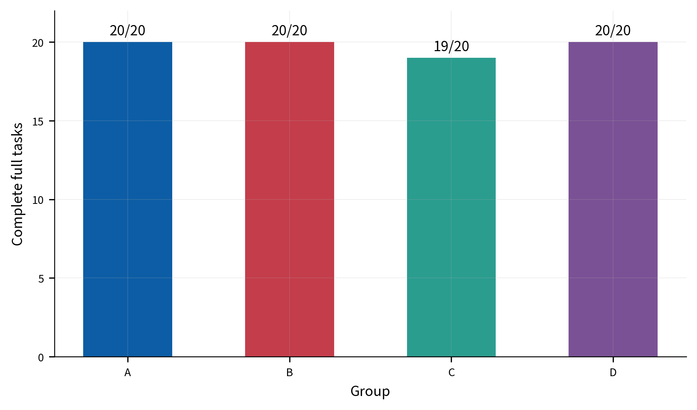
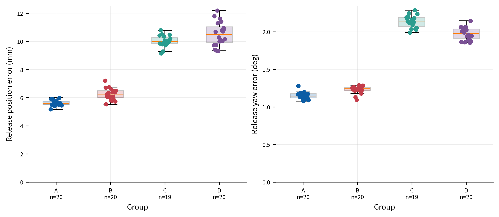
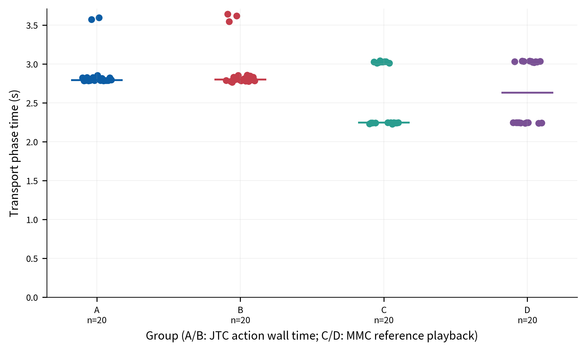
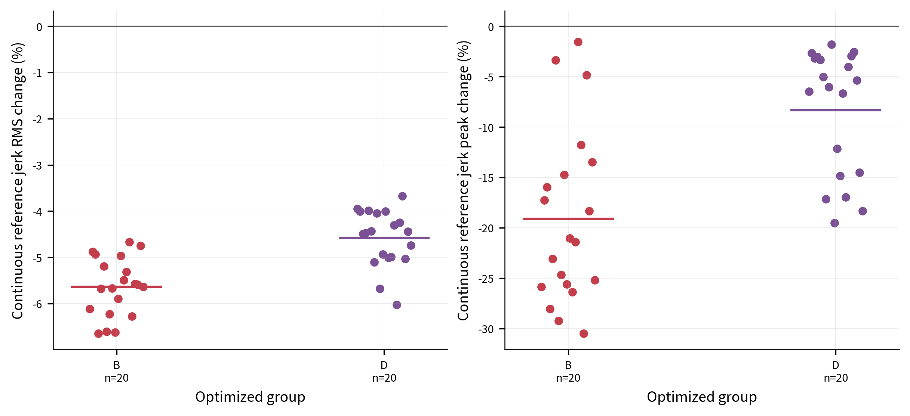
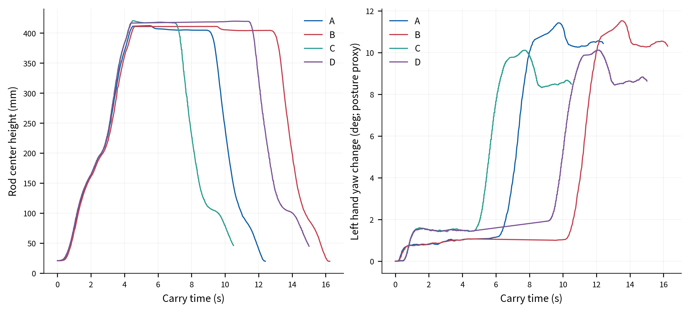

# 固定场景双臂搬运对照实验结果分析

## 实验设置与统计方法

在固定场景中比较四种完整搬运方案：铝杆由初始位置 `(0.50, 0, +10°)` 搬运至目标位置 `(0.40, 0, +20°)`。A为基础轨迹与关节轨迹控制器（JTC）；B为时间优化轨迹与JTC；C为基础轨迹与外部笛卡尔阻抗控制、载荷前馈；D为时间优化轨迹与同一阻抗及载荷前馈。每组进行20次正式尝试，共80次。完整任务包括抓取、抬升、运输、下降、释放和撤退。动作前异常另行记录，不占正式分母。

以下以组均值、样本标准差、中位数和范围描述连续指标，不作显著性或等价性推断。释放误差仅纳入完成释放测量的样本；B、D的平滑度比较则先逐次计算候选相对同次基础参考的变化，再汇总20次。组间数据按独立样本作描述比较，不把同一轮编号视作配对样本。本研究只回答该固定场景的重复性问题。

## 完成率与主要指标

| 组别 | 控制与轨迹 | 完成任务 | 完成率 |
|---|---|---:|---:|
| A | 基础轨迹＋JTC | 20/20 | 100% |
| B | 时间优化轨迹＋JTC | 20/20 | 100% |
| C | 基础轨迹＋阻抗＋载荷前馈 | 19/20 | 95% |
| D | 时间优化轨迹＋阻抗＋载荷前馈 | 20/20 | 100% |

除完成率外，表中连续数据均报告均值 ± 样本标准差；括号内为中位数及最小—最大范围。运输执行时间中A/B测量JTC动作墙钟时长，C/D测量MMC仿真参考播放时长，定义不同，故不跨两种控制方式作速度优劣判断。

| 指标（单位） | A | B | C | D |
|---|---:|---:|---:|---:|
| 释放位置误差（mm；完成测量 n=20/20/19/20） | 5.626 ± 0.196 (5.596; 5.170–5.993) | 6.245 ± 0.405 (6.261; 5.542–7.209) | 10.030 ± 0.397 (10.013; 9.152–10.796) | 10.527 ± 0.844 (10.485; 9.335–12.195) |
| 释放偏航误差（°；完成测量 n=20/20/19/20） | 1.148 ± 0.047 (1.143; 1.076–1.278) | 1.230 ± 0.049 (1.240; 1.096–1.289) | 2.135 ± 0.082 (2.143; 1.990–2.286) | 1.975 ± 0.084 (1.975; 1.853–2.144) |
| 运输计划时长（s；n=20） | 2.310 ± 0.243 (2.231; 2.222–3.021) | 2.343 ± 0.281 (2.229; 2.208–2.999) | 2.593 ± 0.400 (2.245; 2.225–3.040) | 2.636 ± 0.404 (2.631; 2.237–3.039) |
| 实际运输阶段时间（s；n=20） | 2.879 ± 0.241 (2.792; 2.783–3.596) | 2.923 ± 0.294 (2.797; 2.765–3.640) | 2.593 ± 0.400 (2.245; 2.225–3.040) | 2.636 ± 0.404 (2.631; 2.237–3.039) |
| 优化求解耗时（s；n=20） | — | 4.232 ± 0.500 (4.029; 3.924–5.475) | — | 4.780 ± 0.739 (4.757; 3.993–5.642) |
| 承载阶段最大抓取位置参考残差（mm；n=20） | 10.140 ± 0.911 (10.046; 8.589–11.903) | 10.728 ± 0.762 (10.561; 9.765–12.293) | 18.318 ± 0.280 (18.356; 17.875–18.869) | 18.656 ± 0.306 (18.682; 18.077–19.280) |
| 承载阶段最大抓取姿态参考残差（°；n=20） | 1.351 ± 0.050 (1.342; 1.237–1.438) | 1.327 ± 0.054 (1.334; 1.217–1.408) | 3.966 ± 0.102 (3.952; 3.821–4.141) | 3.904 ± 0.114 (3.886; 3.703–4.162) |

各项80次原始逐次观测及完整的组统计见 [`formal_attempts.csv`](formal_attempts.csv) 和 [`group_summary.csv`](group_summary.csv)。所有图保留逐次散点；下方的代表性曲线按组内完成运行的多指标中位数距离选取，不按表现优劣挑选。

### 完成率

图1. 完成率以全部20次正式尝试为分母。C04原始未完成记录保留在C组分母中。

### 释放误差

图2. 释放位置误差为目标平面内XY距离；角度量为偏航误差。散点代表全部有测量的完成运行，箱线用于显示分布；样本数标于组别下方，缺失值未补零。

## 方法间比较

### B相对A：时间优化改善参考平滑度，但没有改善实测搬运结果

B相对A的完成率相同，均为20/20。按每次B候选相对于其自身基础参考的连续时间jerk计算，B组RMS变化均值为−5.64%（SD 0.63个百分点，中位数−5.61%，范围−6.65%至−4.67%）；峰值均值变化为−19.12%（SD 8.65，中位数−21.22%，范围−30.51%至−1.55%）。这是同次参考轨迹的优化结果，不能解释为机械臂实测振动或jerk下降。

实测搬运结果没有呈现对应收益：B的释放位置误差均值为6.245 mm，相比A的5.626 mm高0.619 mm（+11.0%）；偏航误差高0.082°（+7.1%）。同定义的JTC运输动作墙钟时间由2.879 s增至2.923 s，均值差+0.044 s（+1.5%）；计划运输时长均值差为+0.033 s（+1.4%）。因此本批未显示时间优化缩短实际运输时间或提高放置精度。代价是每次约4.23 s优化计算时间。结果支持“参考曲线指标下降”，不支持“完整任务性能整体提高”。

### C相对A：柔顺与载荷补偿组合伴随更大的参考偏差和放置误差

C完成19/20，A完成20/20；单个未完成样本不足以判断控制可靠性差异。C的释放位置误差均值10.030 mm，比A高4.404 mm（+78.3%）；偏航误差均值高0.987°（+86.0%）。承载阶段最大抓取位置/姿态参考残差均值分别为18.318 mm和3.966°，A为10.140 mm和1.351°。这些残差反映手与抓取参考间更大的偏离；在柔顺执行中它们不等同于机械臂跟踪故障，但也不能当作精度改善。

C组杆中心承载阶段Y方向变化范围均值13.616 mm，A为3.722 mm；杆中心X变化范围分别为121.240和105.619 mm。该范围混合了规划路径、杆姿态和执行响应，不单独代表稳定性或误差。代表曲线显示各组杆高度均完成抬升与下降，C/D的左手偏航姿态代理变化范围约10°，A/B约11.4°。由于本次C组同时采用阻抗与载荷前馈，观测差异不能单独归因于阻抗；该组合在本场景呈现较大的参考让步，同时放置误差也较大。

### D相对C及B：组合方案保留RMS参考收益，但未显示一致的综合优势

D与C均采用阻抗和载荷前馈，分别完成20/20与19/20。相对C，D的连续参考jerk RMS逐次变化均值为−4.58%（SD 0.61个百分点，中位数−4.46%，范围−6.02%至−3.68%），峰值均值变化为−8.33%（SD 6.24，中位数−5.70%，范围−19.50%至−1.82%）。D保持了RMS参考改善，但峰值下降幅度小于B组；D的平均RMS改善比B少1.06个百分点，峰值改善少10.79个百分点。两组都是相对于各自每次基础参考计算。

在可比的MMC参考播放时间上，D均值2.636 s，C为2.593 s，增加0.043 s（+1.7%）；中位数分别为2.631与2.245 s，且C/D都呈约2.24 s和3.02 s两个簇，故单一均值/中位数不足以代表全部时间结构。D相对C的释放位置误差均值增加0.497 mm（+5.0%），偏航误差减少0.160°（−7.5%）；一项略差、一项略好，不构成总体精度提升。D优化求解均值为4.780 s，比B多约0.548 s。与B相比，D的释放位置及偏航误差均值分别高4.282 mm（+68.6%）和0.745°（+60.6%），但B与D同时改变了控制方式和是否启用载荷前馈，不能把这些差异解释成优化轨迹的独立效果。

图3. 每个点是一项正式运行；横线表示组内中位数。A/B为JTC动作墙钟时间，C/D为MMC参考播放仿真时间。C/D时间点呈两个簇，组间跨控制方式的时间不作直接快慢结论。

图4. 每个点对应一项B或D运行中候选相对其自身基础参考的变化百分比，横线为组均值；负值表示参考jerk指标下降。图示的是连续时间参考，不是实测机械臂运动jerk。

图5. 每组选择在释放误差和本组运输时间等指标上接近中位数的完成运行；左手偏航变化仅作为姿态代理，不能替代杆姿态直接测量。平面杆中心轨迹见[图6](figures/06_representative_rod_xy.png)。

## 专项载荷与方向性实验的结论边界

完整搬运ABCD批次用于评价完成情况、放置误差、承载运动及参考指标，不能单独量化载荷前馈对沉降的因果贡献，也不以更大的抓取参考偏差直接表示精度更高。载荷前馈作用由单因素悬空保持专项实验说明：每组n=3，0.64 kg载荷均分前馈开启后，0–3 s窗口杆竖直位移中位数由−8.37 mm变为−2.90 mm，按两组中位数的绝对值计算沉降幅值约低65.4%；前馈斜坡后可用窗口中位数由−2.27 mm变为+0.80 mm，表明略有向上余量。窗口约2.42–2.46 s，结果不应写成完整3 s静态保持。该试验结论只针对悬空承载窗口。[专项方法和逐次数据](../../../docs/deliverables/S2_S3_扩展场景与载荷补偿_结果_20261020.md)

方向性刚度专项对照中，两组都启用相同载荷前馈，仅将X方向刚度由400降至200 N/m（每组n=3）。2 N、1 s的+X扰动结束时杆位移中位数由固定增益组1.646 mm增至方向性组2.318 mm；撤力后3 s残余分别为0.620和1.120 mm。较大的位移体现更大的受力让步，而不是更高精度；两组竖向沉降中位数接近（−3.50与−3.97 mm），姿态变化也相近。数据受背景漂移影响，且样本量小，应作为专项扰动现象报告，不与ABCD完整搬运的80次合并。[方向性逐次汇总](../../../experiment_results/reports/s2s3_extended_20261020/directional_summary.csv)

## 未完成样本与结论范围

C04在下降后已确认支撑、开爪并完成约2 s测量等待，但在释放后的truth/feedback联合校验处退出；代码及日志不能区分杆真值读取失败还是接触反馈有效性/新鲜度检查失败。快照显示夹爪打开、保持力清零、无接触；没有日志证据证明发生物理掉落或碰撞。该流程没有完成释放成功标记和撤退，因此按完整流程判据作为一次未完成任务保留。其失败原因尚不能归结为随机因素。

总体而言，时间优化在固定场景的同路径、同时长连续参考上稳定降低了RMS jerk，但需要约4.2–4.8 s计算时间，且本批没有观察到更短的实测任务时间或更小的释放误差。阻抗与载荷前馈组合呈现更大的抓取参考让步和释放误差；D相对C在偏航误差上略低、位置误差上略高，未形成一致的综合改善。完成率均较高，但20次的结果不足以证明组间等价，也不足以据一次C组失败判断柔顺方案不可靠。结论限定于本文固定起终位置及当前仿真模型与配置。

## 研究问题—对照—结果—收益与代价—适用范围

| 研究问题 | 对照方法 | 主要结果 | 收益与代价 | 适用范围 |
|---|---|---|---|---|
| 时间优化是否改善搬运？ | B对A；D对C | B/D的同次连续参考RMS均下降；完成率相同或接近，放置误差未显示一致改善，实测时长未缩短。 | 获得参考曲线平滑度改善；增加约4.23–4.78 s求解耗时，峰值收益依组别而异。 | 固定场景；参考指标不是实测jerk。 |
| 柔顺控制组合产生何种取舍？ | C对A | C完成19/20；抓取参考偏差和释放误差均较大，杆Y向变化范围增加。 | 有更大的受力/跟踪让步空间；本批未见更小放置误差，且C包含载荷前馈。 | 只能评价阻抗与前馈组合，不能拆分单因素效果。 |
| 优化与柔顺组合是否综合更优？ | D对C、D对B | D保留RMS参考改善；D/C放置误差一增一减，播放时长分布有双簇；D/B控制条件不同。 | 平滑度改善仍存在，但弱于B的部分参考指标，且求解较耗时；未呈全面优势。 | 固定场景描述性结果，不作普遍排序。 |
| 前馈和方向刚度各自改变什么？ | 独立悬空保持/扰动专项对照 | 前馈专项沉降中位数减小；降低X刚度后受力位移和撤力后残余增大。 | 前者改善承载高度保持；后者增加指定方向的让步，同时残余也更大。 | 独立专项数据，n=3/组；不与完整搬运批次混算。 |

## 统计与原始材料

统计样本、指标定义、日志等待核对及C04直接原因见[`统计核对与指标说明.md`](统计核对与指标说明.md)。该文档与逐次数据均保留原始失败，不包含后补运行。图表、逐次CSV、组统计及运行目录索引均在本结果目录。
