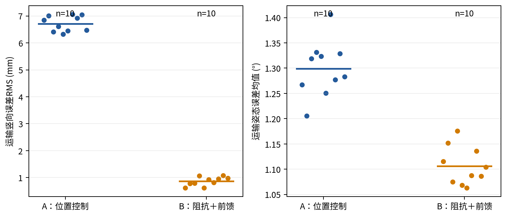
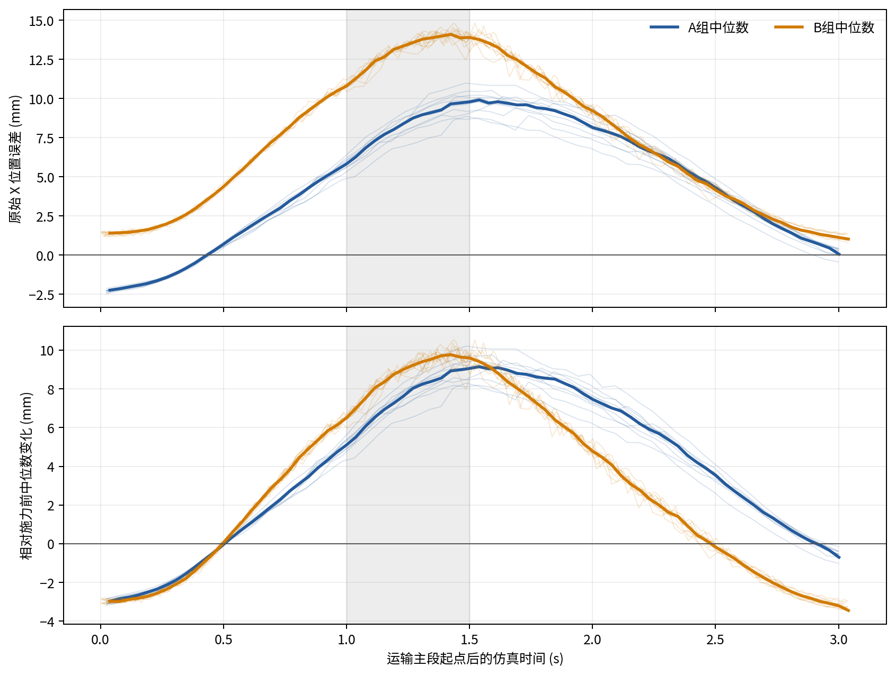
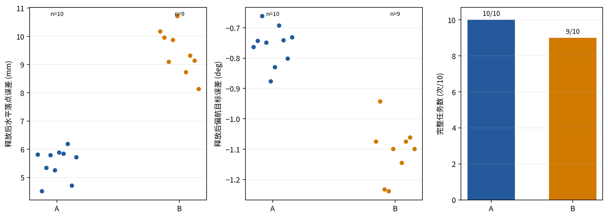

# 完整搬运阻抗与载荷前馈：10次重复结果

> **存档批次，未采用。** 用户于2026-10-27决定本批原定10次及追加B11仅存档，
> 不纳入当前报告、选用图表或主统计。下文保留当时实际分析，不替换10月26日选用数据。
> 详见[存档状态](ARCHIVE_STATUS.md)。

本次计划10次，已接受动作10次，完整完成9次；动作前异常0次另列。
原定10次统计全部计入，未混入旧B样本或后加补充运行，未替换失败。Word未修改。

场景为(0.50,0,+10°)至(0.40,0,+20°)，抬升0.40 m。共同运输主段3.040 s，
主段开始1.0 s后施加world +X总力2 N、持续0.5 s。独立阻抗、载荷前馈和原放置流程保持不变。

## 逐次结果

| 编号 | 完整结果 | 运输竖向RMS/mm | 放置XY误差/mm | 偏航绝对误差/° | 直接中止原因 |
|---|---|---:|---:|---:|---|
| B01 | DONE | 0.622 | 10.177 | 1.075 |  |
| B02 | DONE | 0.784 | 9.953 | 0.942 |  |
| B03 | DONE | 0.793 | 9.094 | 1.232 |  |
| B04 | DONE | 1.063 | 9.877 | 1.238 |  |
| B05 | DONE | 0.623 | 10.717 | 1.099 |  |
| B06 | FAILED | 0.930 | — | — | E_CONTACT_SLIP_OR_DROP |
| B07 | DONE | 0.818 | 8.737 | 1.145 |  |
| B08 | DONE | 0.956 | 9.320 | 1.075 |  |
| B09 | DONE | 1.078 | 9.145 | 1.061 |  |
| B10 | DONE | 0.981 | 8.134 | 1.099 |  |

## 性能对照

A为已有位置控制10次数据，B为本次新执行的10次。以下为描述性均值±标准差，括号内为有效测量数。
| 指标 | A：位置控制 | B：阻抗＋前馈 | 单位 |
|---|---:|---:|---|
| 运输竖向位置误差RMS | 6.71±0.29（10） | 0.86±0.16（10） | mm |
| 运输X向位置误差RMS | 5.97±0.48（10） | 8.47±0.08（10） | mm |
| 运输三维位置误差RMS | 9.06±0.38（10） | 8.91±0.03（10） | mm |
| 运输姿态误差均值 | 1.30±0.06（10） | 1.11±0.04（10） | ° |
| 施力期X向误差最大变化 | 9.02±0.65（10） | 10.07±0.27（10） | mm |
| 撤力后1.0 s的X向变化 | 3.48±0.40（10） | -0.17±0.21（10） | mm |
| 撤力后1.4 s的X向变化 | -0.01±0.24（10） | -2.88±0.16（10） | mm |
| 释放水平落点误差 | 5.51±0.54（10） | 9.46±0.79（9） | mm |
| 释放偏航误差绝对值 | 0.76±0.06（10） | 1.11±0.09（9） | ° |
| 任务尝试墙钟时长 | 31.46±0.43（10） | 34.62±2.39（10） | s |
| 完成任务墙钟时长 | 31.46±0.43（10） | 35.33±0.83（9） | s |

## 另行补充运行

原定10次之后，用户授权追加1次，同参数完成1次。原定结果未删除或覆盖。
全部本轮动作共11次，完整10次；累计有效放置测量见completed_B_runs.csv。
追加B11：DONE，水平放置误差9.339 mm，偏航绝对误差1.263°，中止原因：无。
全部完成任务的放置水平误差均值9.449 mm（n=10），偏航绝对误差均值1.123°（n=10）。这只描述完成任务，不替代原定十次的总体统计。

## 结果解释

本次B组运输竖向误差明显小于位置控制参考数据，但水平跟踪和最终放置精度并未同时改善。
撤力后1.0 s时B更接近施力前水平，随后出现较大的反向偏差，不能概括为整体恢复更好。
B06在下降阶段左侧杆—手位置残差达到20.433 mm，超过既有20 mm条件；
最后记录角残差约3.90°/2.64°，低于5°。未进入放置释放，未取得释放误差；
这是位姿残差触发的任务中止，不是释放真值服务超时，也不单凭错误码认定物理掉落。
表中的尝试耗时包含未完成运行，完成任务耗时另外统计，避免将提前中止当作更快完成。

当前对照评价阻抗与前馈组合，不将差异单独归因于阻抗。没有无扰动搬运组，
施力前后的误差变化含运动背景，不等于独立测得的外力净响应。正负变化应保留，不把反向偏差称为完全恢复。
放置误差只统计已取得有效测量的样本，缺失不补零。全部运行索引在attempts.csv。

