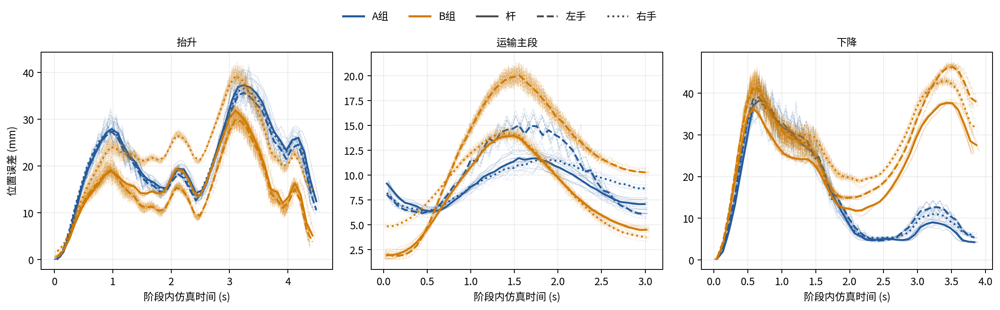
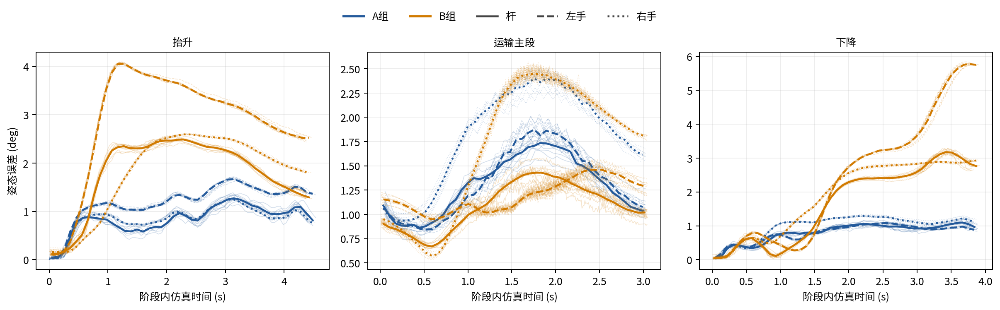
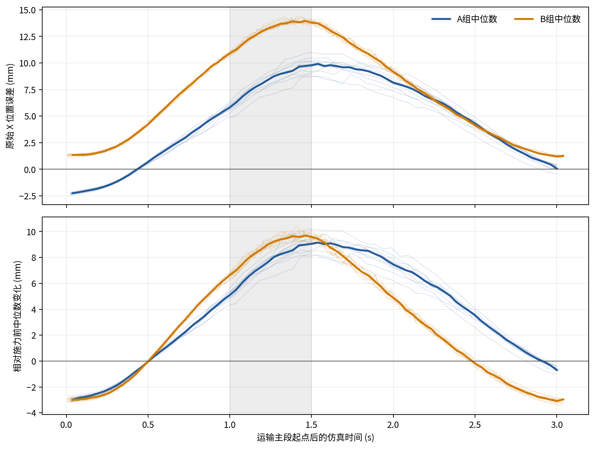
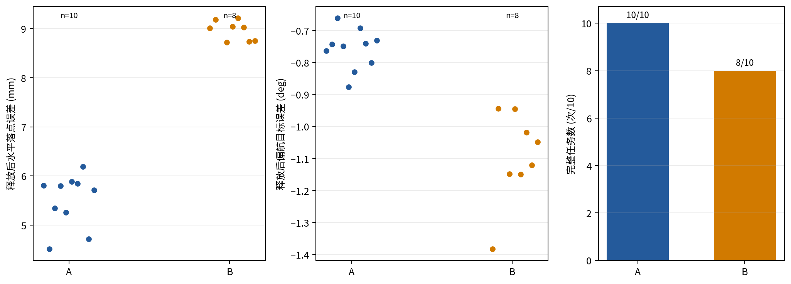

# 完整搬运受力让步对照：结果分析

> 后续释放测量定位：原B02、B07的直接中止环节已按请求时序及源码确定为最终杆真值请求超时，
> 不是已记录到的放置位姿超限。原正式结果仍为A 10/10、B 8/10，不追记成功。
> 复用已有客户端并固定开爪前比较基准后，两次独立完整搬运验证均完成；
> 详见[修复与补充结果](../fullcarry_perturb_ab_20261026_release_repair/results.md)。

## 实验范围与方法

本批次在固定仿真场景中比较两套完整控制方案：A为JTC位置控制；B为独立笛卡尔阻抗及杆载荷前馈。B包含阻抗和载荷前馈两项实现，组间差异评价的是完整方案，不能将差异单独归因于阻抗算法。两组采用相同的共同物体参考、3.040 s运输主段和正常放置流程；正式动作各10次，预试验不纳入统计。B预试验完成全流程；A首次预试验在下降阶段触发杆支撑穿透检查，统一两组下降终端姿态后，A复核运行完成全流程。正式日志确认A组前馈为0 N，B组10次在运输段开始时两臂均已达到3.1392 N。每次正式运行均在运输主段开始1.0 s后，对杆质心施加世界+X方向2 N、持续0.5 s的单次扰动；正式运行20/20均记录了施力起止事件。实际施力起止以`rod_force_events.csv`中的仿真时间为准。没有无扰动组，因此施力前后误差变化不能解释为外力的净响应。

## 任务完成与放置

A组完成10/10，B组完成8/10。两次B组未完成均发生在释放后的最终真值/反馈合并检查，夹爪打开和约2 s释放测量等待已完成，但未进入撤退；该检查的合并错误码未区分真值服务失败和反馈校验失败。两次均保留为未完成任务，不替换。动作前另有2次P2b预抓取路径规划未通过，没有接受预抓取运动请求，作为动作前异常单列。

- A组释放测量：水平落点误差 n=10，均值 5.51，标准差 0.54，中位数 5.75，范围 4.52–6.19 mm；有符号偏航目标误差 n=10，均值 -0.76，标准差 0.06，中位数 -0.75，范围 -0.88–-0.66 deg，偏航误差绝对值 n=10，均值 0.76，标准差 0.06，中位数 0.75，范围 0.66–0.88 deg。仅使用成功完成释放测量的样本，缺失值不补零。

- B组释放测量：水平落点误差 n=8，均值 8.96，标准差 0.20，中位数 9.02，范围 8.72–9.21 mm；有符号偏航目标误差 n=8，均值 -1.09，标准差 0.14，中位数 -1.08，范围 -1.38–-0.94 deg，偏航误差绝对值 n=8，均值 1.09，标准差 0.14，中位数 1.08，范围 0.94–1.38 deg。仅使用成功完成释放测量的样本，缺失值不补零。

## 共同运输与轨迹跟踪

- A组运输主段实测事件时长 n=8，均值 3.07，标准差 0.00，中位数 3.07，范围 3.07–3.08 s（计划3.040 s；事件时长受观测循环采样影响），任务墙钟时长 n=10，均值 31.46，标准差 0.43，中位数 31.31，范围 30.94–32.29 s。杆X向误差RMS n=10，均值 5.97，标准差 0.48，中位数 6.12，范围 5.05–6.72 mm、竖向误差RMS n=10，均值 6.71，标准差 0.29，中位数 6.72，范围 6.32–7.06 mm、三维位置误差RMS n=10，均值 9.06，标准差 0.38，中位数 9.02，范围 8.52–9.56 mm、姿态误差均值 n=10，均值 1.30，标准差 0.06，中位数 1.30，范围 1.21–1.41 deg；双手相对各自参考的平均位置误差 n=10，均值 9.68，标准差 0.35，中位数 9.74，范围 8.98–10.03 mm。

- B组运输主段实测事件时长 n=10，均值 3.04，标准差 0.01，中位数 3.04，范围 3.03–3.05 s（计划3.040 s；事件时长受观测循环采样影响），任务墙钟时长 n=10，均值 35.02，标准差 0.53，中位数 34.94，范围 34.26–35.74 s。杆X向误差RMS n=10，均值 8.41，标准差 0.08，中位数 8.41，范围 8.30–8.53 mm、竖向误差RMS n=10，均值 0.90，标准差 0.20，中位数 0.85，范围 0.62–1.28 mm、三维位置误差RMS n=10，均值 8.85，标准差 0.06，中位数 8.86，范围 8.76–8.95 mm、姿态误差均值 n=10，均值 1.09，标准差 0.04，中位数 1.08，范围 1.02–1.17 deg；双手相对各自参考的平均位置误差 n=10，均值 10.45，标准差 0.09，中位数 10.45，范围 10.34–10.59 mm。

共同参考规划起点连接单独保留，不并入3.040 s主段误差。A/B组逐次实际运输物体参考在共同时间区间内插值比较，跨组逐次组合的最大位置差为0.322 mm，最大姿态差为0.189 deg（逐组合结果见`reference_comparison.csv`），参考路径相近但不完全相同。曲线按各条仿真时间戳插值对齐，未按数组下标配对，也未外推。杆真值服务记录请求与响应时间，杆真值对齐时间采用两者中点作为近似；双手反馈按观测记录时刻对齐。A组两次JTC日志未写入主段结束事件，误差曲线按记录的主段起点加计划3.040 s确定分析窗口，实际事件时长统计仍按有效结束事件计（n=8）。杆—手相对残差是由手位姿和冻结抓取变换推得的几何残差，不等同于直接测得的接触滑移。

## 受力让步与恢复

- A组：施力期间相对施力前X向误差中位数的最大绝对变化 n=10，均值 9.02，标准差 0.65，中位数 9.00，范围 8.18–10.21 mm；脉冲结束附近变化 n=10，均值 8.99，标准差 0.67，中位数 9.00，范围 8.10–10.21 mm。撤力后0.5/1.0/1.4 s时的误差变化均值分别为7.46/3.48/-0.01 mm（有效样本数10/10/10）；撤力后0.5 s至主段末的时间窗平均变化为 n=10，均值 3.29，标准差 0.37，中位数 3.36，范围 2.44–3.89 mm。原始误差与变化曲线同时给出。

- B组：施力期间相对施力前X向误差中位数的最大绝对变化 n=10，均值 9.90，标准差 0.33，中位数 9.97，范围 9.36–10.42 mm；脉冲结束附近变化 n=10，均值 9.52，标准差 0.31，中位数 9.49，范围 9.06–10.14 mm。撤力后0.5/1.0/1.4 s时的误差变化均值分别为4.89/-0.16/-2.80 mm（有效样本数10/10/10）；撤力后0.5 s至主段末的时间窗平均变化为 n=10，均值 0.05，标准差 0.16，中位数 0.04，范围 -0.17–0.31 mm。原始误差与变化曲线同时给出。

按每次运行自身施力前X误差中位数中心化，B组施力期最大变化均值比A组高0.88 mm；B组误差变化均值从撤力后0.5 s的4.89 mm降至1.0 s的-0.16 mm，并在1.4 s时为-2.80 mm；A组对应为7.46/3.48/-0.01 mm。B组较快接近施力前水平，随后出现更大的反向偏差，不能概括为持续稳定回零。上述响应包括完整控制系统的轨迹跟踪、承载和场景演化；由于缺少无扰动对照，不将全部误差变化归因于这次外力。让步较大需结合恢复残差、放置误差和完成情况判断，不能直接称为更优。

## 结果解释与适用范围

综合而言，B组的竖向跟踪误差较小；在本扰动时序下，施力后X向偏差更快接近施力前水平，但到撤力1.4 s时平均已转为−2.80 mm，表现出反向超调，不能称为稳定回零。代价是水平让步更大，完成释放测量的B样本落点误差和偏航误差绝对值均值高于A组，且两次释放后校验未完成。A组完成率为10/10，B组为8/10；这些结果支持在承载姿态跟踪和短时扰动响应需求下继续考察B方案，同时要求改进释放后验证与落点表现。B组两次未完成的直接物理原因未由合并检查记录区分，不能据此判定为控制或搬运失败。本实验仅适用于固定起终点、共同名义物体路径和指定2 N短时扰动下的两套完整控制方案，不外推至任意起点、角度或载荷。均值和标准差为描述性统计，未用不同编号的独立初始化运行冒充重复物理配对。

## 图表

图1　杆和双手在抬升、运输主段及下降阶段的参考位置误差。细线为逐次运行，粗线为组内时间分箱中位数。

图2　杆和双手相对各自姿态参考的角误差。细线为逐次运行，粗线为组内时间分箱中位数。

图3　杆的X向原始参考误差及相对本次运行施力前中位数的变化。灰色区域为计划施力区间；细线为逐次运行，粗线为组内中位数。

图4　释放后水平落点误差、带符号偏航目标误差及完整任务次数。散点表示全部有效逐次测量。

逐次测量位于`formal_attempts.csv`、`aligned_tracking_samples.csv`和`disturbance_response_samples.csv`，组统计见`group_summary.csv`；逐次共同参考差异见`reference_comparison.csv`。
