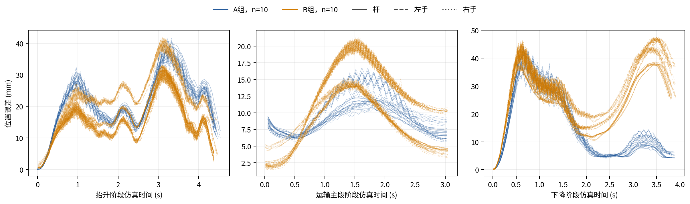
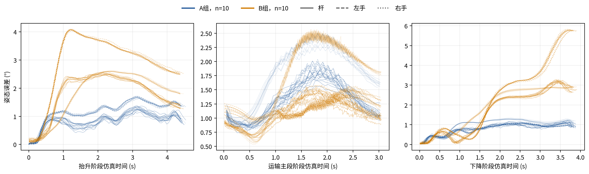
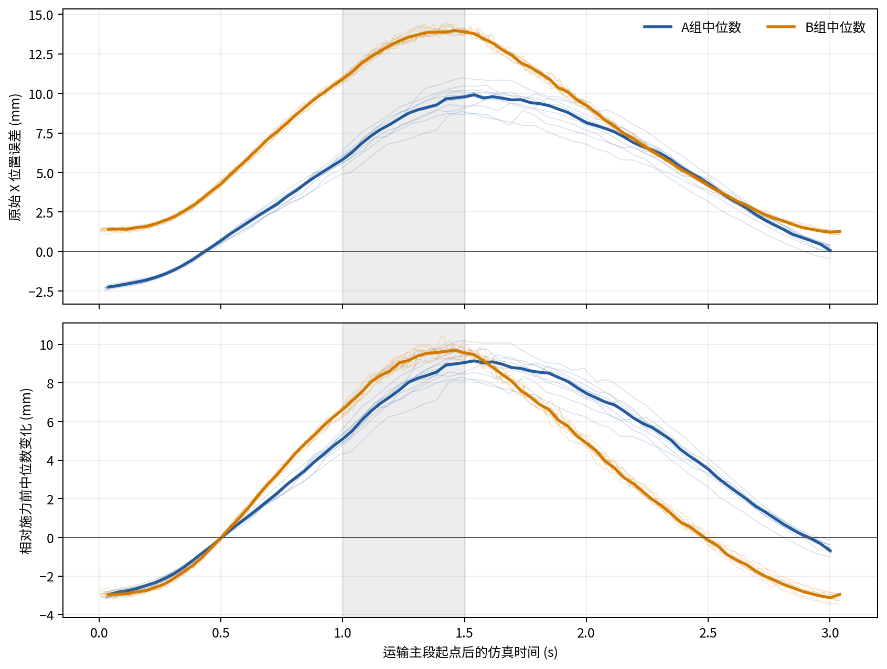
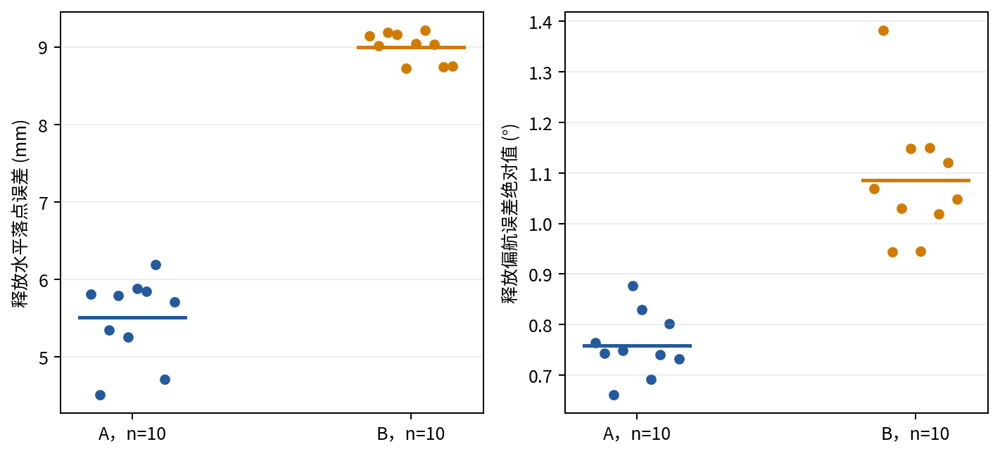

# 完整搬运性能对照：有效运行分析

A组采用位置控制，B组采用独立笛卡尔阻抗与载荷前馈。下表和图按每组10次具有完整测量的运行汇总。
B组有2次运行因释放后杆真值请求超时未获得完整测量，排除出本性能分析，并在修复测量连接后补充2次；
补充运行保持控制参数、名义物体参考、运输时长及外力设置一致。排除和补充为本次排查后确定，不是预先设定的排除规则。
补充运行对应有效样本表的B02、B07位置，真实运行ID和替换关系见replacement_map.csv。
本分析描述有效完整运行的性能，不估计全部尝试的任务成功率，也不表示两组同一冻结版本、同一轮随机配对。

| 指标 | A，均值±标准差 | B，均值±标准差 | 单位 |
|---|---:|---:|---|
| 运输竖向误差RMS | 6.71±0.29 | 0.86±0.15 | mm |
| 运输X向误差RMS | 5.97±0.48 | 8.45±0.09 | mm |
| 运输三维位置误差RMS | 9.06±0.38 | 8.87±0.07 | mm |
| 运输姿态误差均值 | 1.30±0.06 | 1.10±0.05 | ° |
| 施力期X向误差最大变化 | 9.02±0.65 | 9.88±0.32 | mm |
| 撤力后1.0秒X向误差变化 | 3.48±0.40 | -0.14±0.21 | mm |
| 撤力后1.4秒X向误差变化 | -0.01±0.24 | -2.82±0.20 | mm |
| 释放水平落点误差 | 5.51±0.54 | 9.00±0.19 | mm |
| 释放偏航误差绝对值 | 0.76±0.06 | 1.09±0.13 | ° |
| 任务墙钟时长 | 31.46±0.43 | 35.21±0.75 | s |

B组的竖向跟踪误差较小；撤力后1.0 s较接近施力前水平，1.4 s则出现较大的反向偏差。
B组放置误差及任务时长较大。没有无扰动组，因此误差变化并非独立测得的外力净响应；
B组收益属于阻抗与载荷前馈组合，不能归因于阻抗单一因素。

图示均为上述有效运行。正式尝试的完整结果及原图仍保存在原批次；两次技术中断见technical_exclusions.csv，
其任务状态未改为DONE。修复开发中的另外两次未完成动作仍单列于上级attempts.csv。

报告可采用的简短方法说明：‘两组各分析10次有效完整运行。B组另有2次运行因释放测量超时未纳入性能分析，修复测量连接后补充2次。’
不能将本表的样本数作为原批次100%任务完成率。

